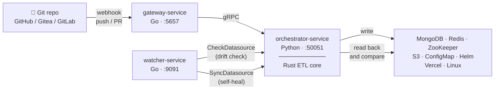
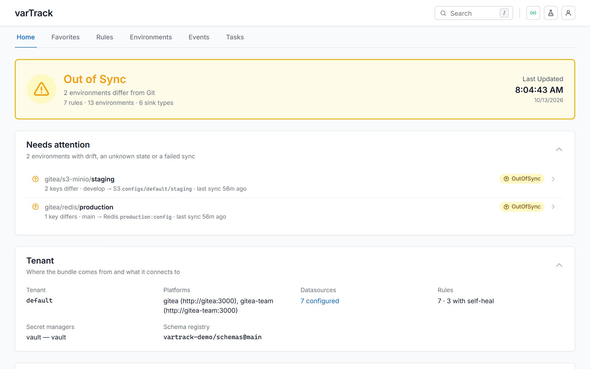
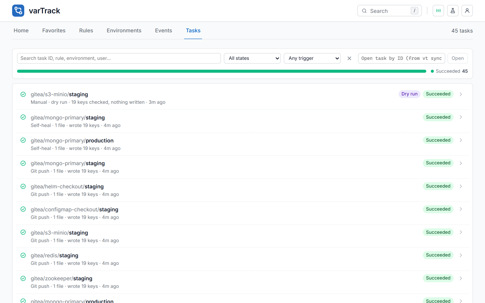

# varTrack

**GitOps-native configuration sync.** Push a file to Git — VarTrack writes it to MongoDB, Redis, ZooKeeper, S3, ConfigMaps, Helm, Vercel, or a Linux server automatically. If someone edits the database directly, VarTrack detects it and restores the correct state.

[](https://github.com/jarin-devoss/varTrack/actions/workflows/ci.yml)
[](https://codecov.io/gh/jarin-devoss/varTrack)
[](LICENSE)
[](https://hub.docker.com/u/jarin-devoss)

[Quick Start](#quick-start) · [Try the demo](#try-it-in-one-command) · [CLI](cli/README.md) · [Config reference](#configuration-reference--configcue) · [Examples](examples/) · [**Documentation**](https://jarin-devoss.github.io/varTrack/)

---

## What it does

You commit a config file to Git. VarTrack reads it and writes the values to every configured sink:

```yaml
# configs/app.yaml — lives in your Git repo
database_host: mongo.prod.internal
feature_flag_dark_mode: true
max_connections: 50
```

Push to `main` → VarTrack automatically syncs to all configured sinks:

```
MongoDB        → collection "production-config"
Redis          → hash "production:cfg"
S3             → key prefix acme/production/
Kubernetes     → ConfigMap "myapp-production"
Helm           → release values "app-production"
Vercel         → environment variables prefixed "production_"
Linux server   → /etc/app/production.env
ZooKeeper      → znodes under /acme/production/
```

Branch `develop` maps to `staging`, PR #42 maps to `pr-42` — each environment is isolated in every sink automatically.

---

## Try it in one command

The fastest way to see VarTrack in action is the end-to-end demo. It starts a local Git server, MongoDB, ZooKeeper, Redis, and all three VarTrack services pre-configured:

```bash
cd e2e
docker compose up
```

Push a config change to the local repo and watch it sync automatically.

---

## Why VarTrack?

Git is a good home for application configuration, but the values your applications read at runtime live in datastores — MongoDB documents, Redis hashes, ZooKeeper znodes, S3 objects, Linux `.env` files — and nothing keeps them in step with Git.

VarTrack fills that gap. It treats Git as the single source of truth for **application configuration data**, and writes it to the datastores your applications actually read.

| | VarTrack |
|---|---|
| Target | MongoDB, Redis, ZooKeeper, S3, ConfigMap, Helm, Vercel, Linux |
| Drift detection | Any datasource |
| Secret management | HashiCorp Vault + `@secret()` annotations |
| Schema validation | CUE per tenant, enforced before every write |

It works alongside whatever deploys your services: VarTrack only keeps their runtime config in sync.

**VarTrack is the right fit if you:**

- Store config, feature flags, or environment variables in any combination of MongoDB, Redis, S3, ZooKeeper, Kubernetes, Helm, Vercel, or Linux servers — and want Git to be the single authority
- Have multiple environments (dev, staging, production) and want changes to flow automatically on push
- Need one push to fan out to multiple sinks at once — write to a ConfigMap, a Helm release, and an S3 object in parallel
- Want drift detection — if someone edits a value directly in any sink, VarTrack restores the correct state automatically
- Need secrets to stay in Vault and never touch Git — `@secret()` annotations resolve at sync time

---

## Features

### Sync
- **8 sink types** — MongoDB, Redis, ZooKeeper, S3, Kubernetes ConfigMap, Helm, Vercel, Linux server (SSH)
- **7 config formats** — YAML, JSON, TOML, .env, INI, HCL, XML — format auto-detected from file extension
- **Multi-sink fan-out** — one push writes to multiple sinks in parallel from one rule set
- **4 sync strategies** — `AUTO` (cost-model picks for you), `GIT_UPSERT_ALL`, `GIT_SMART_REPAIR`, `LIVE_STATE`
- **Stale key pruning** — once per environment, after all its files are written, delete the keys varTrack wrote before that Git no longer holds; `prune.protection` globs keep keys that must never go, and a key changed outside varTrack is kept and reported

### Routing & environments
- **`destination_template`** — control exactly where data lands per rule using `{tenant}` and `{env}` placeholders
- **Environment resolution** — map branch names, PR numbers, tags, or file paths to environment names
- **Layered rules** — `config.cue` → the tenant's `bundle.json` → a repository's `vartrack.json` → `force`; each layer overrides the one before, keys only `config.cue` sets stay out of the lower layers, and shared settings come in with `extends` presets
- **Multi-platform** — GitHub webhooks fully supported; GitLab, Bitbucket driver interface ready to extend

### Validation & safety
- **CUE schema validation** — validate every payload against a per-tenant schema before any write
- **Dry-run mode** — simulate any sync without touching a datasource; `prune: {dry_run: true}` audits deletes independently
- **`@secret()` annotations** — resolve Vault secrets into config values at ETL time; values masked as `***` in dry-run reports
- **`@logger()` annotations** — emit structured change-log entries when specific fields change value

### Drift detection
- **Drift detection** — watcher-service polls continuously; the orchestrator reads the sinks and compares them, key by key, with what it last synced from Git. `suspend` pauses a rule, `drift_ignore` lists keys the application changes itself
- **Self-heal** — set `self_heal: true` on a rule and VarTrack restores correct state automatically on drift
- **Leader election** — ZooKeeper or Redis distributed lock keeps multi-replica watchers in sync

### Operations
- **CLI (`vt`)** — push any local file directly from terminal or CI/CD without a Git push; `vt validate-config` checks a `vartrack.json` or `bundle.json` before it is pushed
- **Git-permission auth** — the CLI API asks the rule's Git platform what the caller's own token may do (push syncs, read validates and dry-runs); an optional OPA policy adds per-env, per-datasource rules
- **Web UI with Git sign-in** — every tenant at once, each user seeing the rules their Git account can read
- **Observability** — OpenTelemetry traces, Prometheus metrics, and structured logs with optional ELK shipping on every service

---

## How it works



1. You push a config file to Git.
2. The **gateway-service** (Go) receives the webhook, verifies the HMAC signature, and forwards it via gRPC.
3. The **orchestrator-service** (Python) fetches the file from Git, validates it against a CUE schema, runs the **Rust ETL core** (diff, flatten, merge, prune) for performance-critical operations, and writes to all configured sinks.
4. The **watcher-service** (Go) asks the orchestrator, on a configurable interval, whether each datasource still matches Git; the orchestrator reads the sinks back and compares. When a value diverges, the watcher logs the delta and — if `self_heal: true` — has the orchestrator restore correct state.

> **Why Rust inside the orchestrator?** The ETL core (diff, flatten, merge, prune) is implemented in Rust and called from Python via FFI. This keeps the hot path allocation-free and handles multi-megabyte config payloads without GC pressure, while the Python layer handles I/O, Vault, and sink drivers.

| Service | Language | Role |
|---|---|---|
| **gateway-service** | Go | Webhook receiver, platform routing, gRPC forwarder |
| **orchestrator-service** | Python | ETL pipeline, CUE validation, multi-sink writer |
| **rust_core** | Rust (FFI) | Diff, flatten, merge, prune — hot path |
| **watcher-service** | Go | Drift detection, self-heal trigger |
| **vt** | Go | CLI for manual sync and CI/CD integration |

---

## Where configuration lives

A rule is built from up to three files, each owned by a different team and kept in a different place. Each layer overrides the one before it; `config.cue`'s `force` block is applied last.

| File | Lives in | Edited by | Holds |
|---|---|---|---|
| `config.cue` | the varTrack hosts (`CONFIG_PATH`), read by every service | the team that runs varTrack | platforms, datasources and their credentials, the rules, `force` |
| `bundle.json` | the root of a tenant's schema repository, next to its CUE schemas | the tenant | the tenant's settings for the rules `config.cue` defines |
| `vartrack.json` | the pushed config repository (`vartrack.json`, or under `.github/`, `.gitea/`, `.gitlab/`), read at the pushed commit | the repository's owners | the repository's overrides: `branch_map`, `root_key`, `prune`, `sync_mode`, … |

Which file may set which option is generated from `proto/vartrack/v1/models/rule.proto` into the [Rule options](docs/configuration/rule-options.md) reference; [Configuration files](docs/configuration/index.md) walks through an example of the three files and the rule they make. `vt validate-config` checks a `vartrack.json` or `bundle.json` before it is pushed.

---

## Quick Start

### Option A — Docker Compose (recommended)

The fastest way to run varTrack against your own GitHub repos:

```bash
git clone https://github.com/jarin-devoss/vartrack
cd vartrack
cp .env.example .env          # fill in MONGO_ROOT_PASSWORD at minimum
# write your config.cue (see Where configuration lives above)
docker compose up -d
```

Register a webhook in your GitHub repo pointing to `http://your-server:5657/webhooks/mongo` and push a config file — varTrack syncs it automatically.

See the [Docker Compose guide](docs/deployment/docker-compose.md) for the full walkthrough, `.env` reference, and scaling options.

---

### Option B — Build from source

#### Prerequisites

- Go 1.21+ · Python 3.11+ · a Celery broker (Redis or MongoDB) · at least one configured sink
- `buf` CLI ([install](https://buf.build/docs/installation)) — only needed to build from source

#### 1. Clone and generate proto code

```bash
git clone https://github.com/jarin-devoss/vartrack
cd vartrack
buf generate
```

`.gitattributes` keeps the `.proto` files LF on every OS, so `buf generate` gives the same Go code on Windows and Linux (a checkout made before that needs `rm -rf proto && git checkout -- proto`). `buf generate` writes the Go code once, to `libs/go/gen` (the gateway and the watcher both build against that module), and the Python stubs to `orchestrator-service/app/generated`.

#### 2. Write your `config.cue`

```cue
bundle: {
  platforms: [{
    github: {
      endpoint:        "https://github.com"
      push_event_name: "push"
      pr_event_name:   "pull_request"
      secret:          "my-webhook-secret"
    }
  }]

  datasources: [{
    mongo: {
      endpoint:   "mongodb://localhost:27017"
      database:   "vartrack"
      collection: "variables"
    }
  }]

  rules: [{
    platform:             "github"
    datasource:           "mongo"
    file_name:            "configs/app.yaml"    // which file in each repo to watch
    repositories:         ["my-org/*"]          // glob pattern — which repos trigger this
    destination_template: "{env}-config"        // collection name resolved at sync time
    self_heal:            true                  // restore on drift automatically
    branch_map: {
      main:    "production"
      develop: "staging"
    }
  }]
}
```

#### 3. Start the services

```bash
# gateway-service
APP_ENV=dev \
ORCHESTRATOR_ADDR=localhost:50051 \
CONFIG_PATH=config.cue \
go run ./gateway-service/cmd

# orchestrator-service (new terminal)
cd orchestrator-service
pip install -e .
uvicorn main:app --host 0.0.0.0 --port 8000 &
celery -A app.worker.celery worker --queues=webhooks,sync -l info

# watcher-service (new terminal)
ORCHESTRATOR_ADDR=localhost:50051 \
CONFIG_PATH=config.cue \
go run ./watcher-service/cmd
```

#### 4. Register a webhook in GitHub

Point your repo webhook to `http://your-server:5657/webhooks/mongo`:
- Content type: `application/json`
- Secret: the value from `secret` in your `config.cue`
- Events: **Pushes** and **Pull requests**

Every push now triggers a sync automatically.

---

## `destination_template` — controlling where data lands

This single field controls the storage path, collection name, or key prefix in every sink:

```cue
destination_template: "{env}-config"
// push to "main"    → branch_map resolves "production" → writes to "production-config"
// push to "develop" → branch_map resolves "staging"    → writes to "staging-config"
// PR #42 with pr_as_env: true                          → writes to "pr-42-config"
```

| Sink | What it controls | Example template | Resolved value |
|---|---|---|---|
| MongoDB | Collection name | `"{env}-config"` | `production-config` |
| ZooKeeper | znode root path | `"/{tenant}/{env}"` | `/acme/pr-42` |
| Redis | Key prefix | `"{env}:cfg"` | `production:cfg` |
| S3 | Key prefix | `"{tenant}/{env}/"` | `acme/production/` |
| Linux server | Remote file path | `"/etc/app/{env}.env"` | `/etc/app/production.env` |
| Helm | Release name | `"app-{env}"` | `app-production` |
| ConfigMap | ConfigMap name | `"myapp-{env}"` | `myapp-production` |

---

## Environment resolution

When a webhook fires, VarTrack resolves the target environment in this order:

1. `branch_map[branch]` — explicit mapping (e.g. `main` → `production`)
2. `file_path_map[file_path]` — glob pattern match on the changed file path
3. `pr_as_env: true` → environment = `pr-{number}`
4. `branch_as_env: true` → environment = branch name
5. `tag_as_env: true` → environment = tag name
6. `"default"` fallback

---

## Sync strategies

| Mode | When to use |
|---|---|
| `AUTO` | Recommended — VarTrack picks the strategy based on payload size |
| `GIT_UPSERT_ALL` | Write all keys from Git; best for small configs |
| `GIT_SMART_REPAIR` | On MongoDB, read what is stored first and write only what changed; best for large configs. Other sinks write every key |
| `LIVE_STATE` | Written like `GIT_UPSERT_ALL` |

---

## Multi-sink fan-out

Push once, write to multiple sinks in one go:

```cue
rules: [
  { platform: "github", datasource: "mongo",        file_name: "config.yaml", destination_template: "{env}-config" },
  { platform: "github", datasource: "configmap",    file_name: "config.yaml", destination_template: "myapp-{env}" },
  { platform: "github", datasource: "linux_server", file_name: "config.yaml", destination_template: "/etc/app/{env}.env" },
]
```

Any combination works — mix and match MongoDB, Redis, S3, ConfigMap, Helm, Vercel, ZooKeeper, and Linux servers. The web UI's Rules page shows each rule with its desired state in Git, its current state in the sink, and every environment's status:


---

## Drift detection and self-heal

The watcher-service polls every configured datasource at a set interval. When a value doesn't match the Git baseline:

1. Logs the drift event and increments the `vartrack_watcher_drift_total` Prometheus counter
2. If `self_heal: true` on the rule → calls the orchestrator to re-run the full ETL pipeline
3. Correct state is restored — no manual intervention needed

Drift on a rule without self-heal stays until someone syncs from Git, and the web UI shows it key by key — here a value someone changed directly in Redis:


Running multiple watcher replicas? Enable leader election so only one replica runs the heal loop, by naming the datasource they elect a leader on:

```cue
bundle: {
  watcher_leader_election_datasource: "redis"  // a Redis or ZooKeeper datasource of the bundle
}
```

---

## Web UI

A browser console for rules, environments, drift, sync history and dry runs, reading from your running varTrack services. With sign-in on, users sign in with their Git account and see every tenant's rules whose repositories that account can read; admins see everything. See [Web UI sign-in](docs/configuration/auth.md#web-ui-sign-in-with-your-git-platform):

```bash
cd ui && npm install && npm run dev   # http://localhost:5173
```

With Docker Compose it runs on port 8080. See the [UI README](ui/README.md) for the API it reads and a local stack with real sinks. The home page puts what needs attention first:



---

## CLI — `vt`

Sync any local file directly without a Git push — runs the same ETL pipeline as a webhook:

```bash
# Install
cd cli && go build -o vt ./cmd && mv vt /usr/local/bin/vt

# Authenticate with your Git token (GitHub or Gitea personal access token)
vt login --server https://gateway.example.com --token "$GIT_TOKEN"

# Sync to a Kubernetes ConfigMap
vt sync --file configs/app.yaml --datasource configmap --env production --wait

# Sync to a Helm release
vt sync --file configs/app.yaml --datasource helm --env staging --wait

# Dry-run: see what would be written to S3 without touching anything
vt sync --file configs/app.yaml --datasource s3 --env staging --dry-run

# Validate against the CUE schema (great for PR checks)
vt validate --file configs/app.yaml --datasource linux-server

# Check a vartrack.json or bundle.json the way a sync will read it
vt validate-config vartrack.json

# A datasource written by rules on several platforms needs the platform
vt sync --file configs/app.yaml --datasource mongo --platform gitea --env staging

# Inspect tasks
vt task list
vt task get <task-id>
```

The same tasks are on the web UI's Tasks page, each with what triggered it — a Git push, self-heal, or a manual sync or dry run:



**In GitHub Actions:**

```yaml
- name: Sync config to production
  env:
    VARTRACK_SERVER: https://gateway.example.com
    VARTRACK_TOKEN: ${{ secrets.VARTRACK_TOKEN }}
  run: vt sync --file configs/app.yaml --datasource helm --env production --wait
```

See the full [CLI documentation](cli/README.md) for all commands, flags, and access control.

---

## Supported config formats

| Extension | Format |
|---|---|
| `.yaml`, `.yml` | YAML |
| `.json` | JSON |
| `.toml` | TOML |
| `.env` | dotenv / KEY=VALUE |
| `.ini` | INI |
| `.hcl` | HCL (Terraform-style) |
| `.xml` | XML |

Format is auto-detected from the file extension.

---

## Full bundle example

```cue
bundle: {
  platforms: [{
    github: {
      endpoint:        "https://github.com"
      push_event_name: "push"
      pr_event_name:   "pull_request"
      secret:          "my-webhook-secret"
    }
  }]

  datasources: [
    {
      mongo: {
        endpoint:   "mongodb://mongo:27017"
        database:   "vartrack"
        collection: "variables"
      }
    },
    {
      s3: {
        bucket: "my-config-bucket"
        region: "us-east-1"
        access_key_id:     "AKIA..."
        secret_access_key: "..."
      }
    },
    {
      linux_server: {
        host:     "app-server.example.com"
        username: "deploy"
        ssh_key:  {private_key: {file: "/run/secrets/deploy_key"}}   // a key file, not inline
      }
    }
  ]

  rules: [
    {
      platform:             "github"
      datasource:           "mongo"
      file_name:            "configs/app.yaml"
      repositories:         ["my-org/*"]
      sync_mode:            "AUTO"
      destination_template: "{env}-config"
      self_heal:            true
      branch_map: {
        main:    "production"
        develop: "staging"
      }
    },
    {
      platform:             "github"
      datasource:           "s3"
      file_name:            "configs/app.yaml"
      repositories:         ["my-org/*"]
      destination_template: "configs/{env}/"
      branch_map: { main: "production", develop: "staging" }
    },
    {
      platform:             "github"
      datasource:           "linux_server"
      file_name:            "configs/app.yaml"
      repositories:         ["my-org/*"]
      destination_template: "/etc/app/{env}.env"
      branch_map: { main: "production", develop: "staging" }
    }
  ]

  schema_registry: {
    platform: "github"
    repo:     "my-org/schemas"
    branch:   "main"
  }

  secret_managers: [{
    vault: {
      endpoint:    "https://vault.mycompany.com"
      mount_point: "secret"
      kv_version:  2
      token_auth: { token: "hvs.xxxx" }
    }
  }]

  // Optional gateway tuning
  max_webhook_body_bytes: 10485760  // 10 MiB (default — omit to keep default)
}
```

---

## API reference

### gateway-service (port 5657)

| Method | Path | Description |
|---|---|---|
| `POST` | `/webhooks/{datasource}` | Receive a platform webhook |
| `POST` | `/webhooks/schema-registry` | Schema-registry push trigger |
| `GET` | `/health/liveness` | Liveness probe |
| `GET` | `/health/readiness` | Readiness probe |
| `POST` | `/v1/cli/sync`, `/v1/cli/validate`, `/v1/cli/validate-config` | The CLI API, authorized by the caller's Git token |
| `GET` | `/v1/cli/tasks`, `/v1/cli/tasks/{id}` | CLI task status |

### orchestrator-service (port 8000 HTTP / 50051 gRPC)

| Method | Path | Description |
|---|---|---|
| `POST` | `/v1/webhooks/{datasource}` | Direct HTTP ingestion |
| `POST` | `/v1/webhooks/{datasource}/dry-run` | Simulate without writing |
| `GET` | `/v1/ui/*` | The web UI's read API, every tenant the viewer may see (`?tenant=` narrows) |
| `GET` | `/docs` | OpenAPI / Swagger UI |
| gRPC | `ProcessWebhook` | Called by gateway-service |
| gRPC | `CLIService` (`SyncFile`, `ValidateFile`, `ValidateConfig`, `GetTask`, `ListTasks`) | Called by gateway-service for the CLI API |
| gRPC | `ListWatchTargets`, `CheckDatasource`, `SyncDatasource` | Called by watcher-service: which rules to watch, whether a datasource still matches Git, and self-heal |

---

## Testing

```bash
# shared Go module (generated code, bundle loader)
cd libs/go && go test ./...

# gateway-service
cd gateway-service && go test ./...

# watcher-service
cd watcher-service && go test ./...

# cli
cd cli && go test ./...

# orchestrator-service
cd orchestrator-service
pip install -e ".[test]"
pytest tests/

# web UI
cd ui && npm install && npm run typecheck && npm test

# End-to-end (Docker Compose)
cd e2e && docker compose up
```

---

## Docker

```bash
docker build -t jarin-devoss/gateway-service:latest      --file ./gateway-service/Dockerfile .
docker build -t jarin-devoss/orchestrator-service:latest --file ./orchestrator-service/docker/Dockerfile .
docker build -t jarin-devoss/watcher-service:latest      --file ./watcher-service/Dockerfile .
```

All three build from the repository root: the gateway and the watcher use the shared Go module in `libs/go`, and the orchestrator image generates its Python gRPC stubs from `proto/` in its own build stage, so an image does not depend on a `buf generate` run in the checkout.

Pre-built multi-arch images (`linux/amd64`, `linux/arm64`) are published on every tagged release:

```bash
docker pull jarin-devoss/gateway-service:latest
docker pull jarin-devoss/orchestrator-service:latest
docker pull jarin-devoss/watcher-service:latest
```

---

## Repository layout

```
varTrack/
├── config.cue                    # Shared CUE bundle (all services read this)
├── proto/                        # Protobuf definitions
├── buf.gen.yaml                  # Buf code-generation config (one template)
├── libs/go/                      # Go — generated code, bundle loader, secret files (shared)
│
├── gateway-service/              # Go — HTTP ingress, webhook receiver, CLI API
├── orchestrator-service/         # Python + Rust — ETL pipeline, sink writer
├── watcher-service/              # Go — drift detection, self-heal
├── cli/                          # Go — vt command-line tool
├── ui/                           # React — web UI
├── examples/                     # Example bundles and config files
└── e2e/                          # End-to-end demo + test suite
```

---

## Security

Webhook signatures (HMAC-SHA256), replay protection, rate limiting, and mTLS are enforced automatically in production (`APP_ENV=production`). See [SECURITY.md](SECURITY.md) for the full security model.

---

## License

Apache License 2.0 — see [LICENSE](LICENSE).
