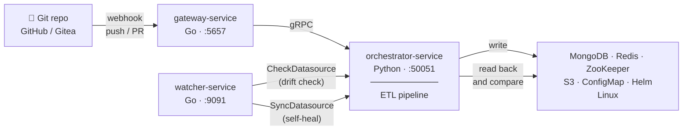
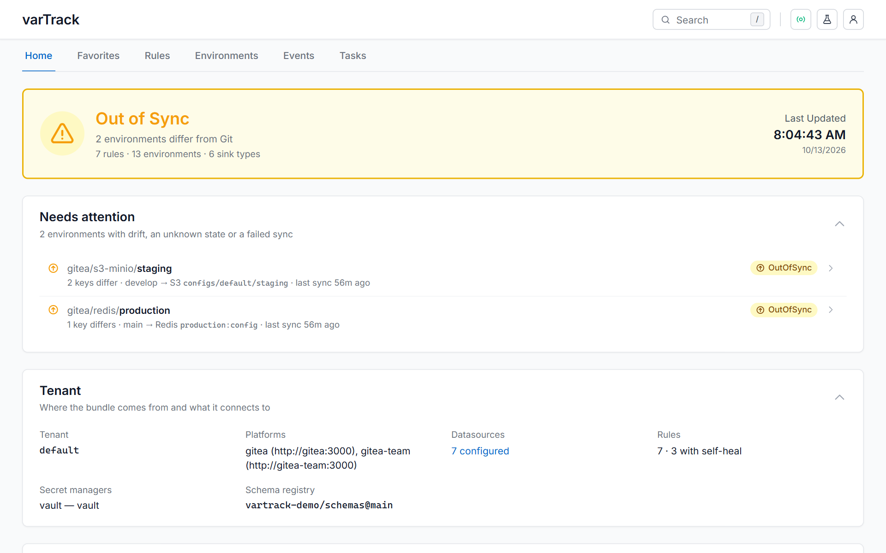
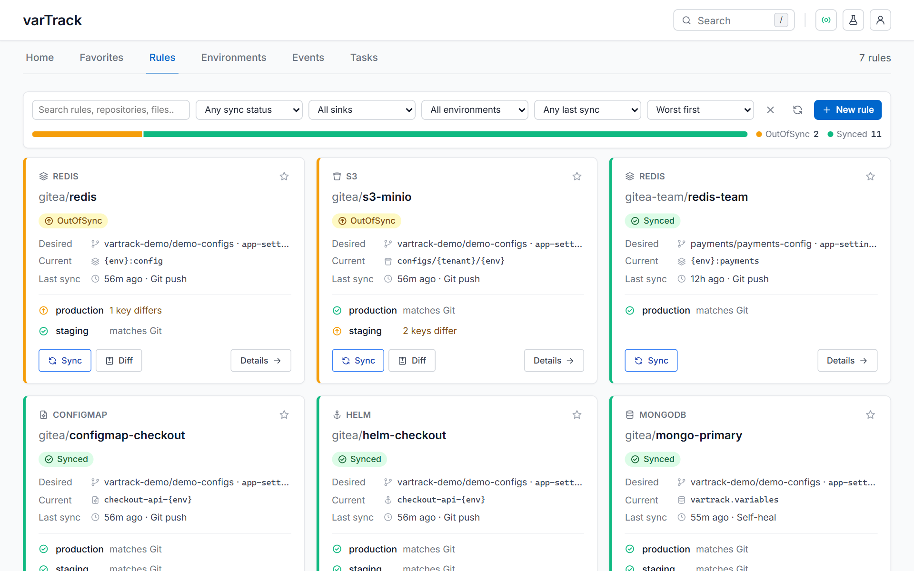
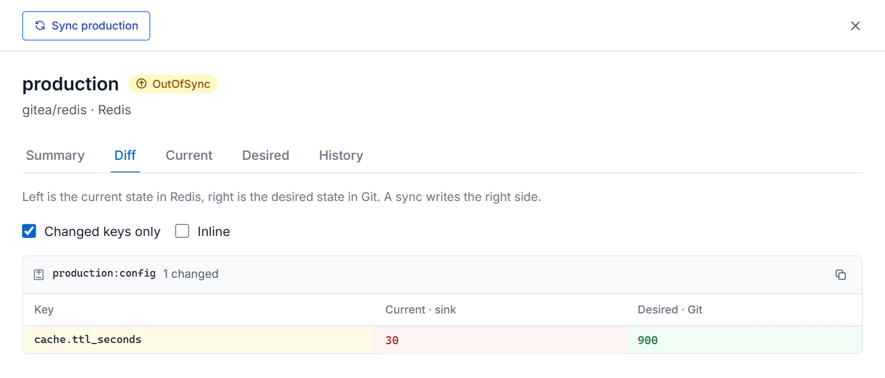
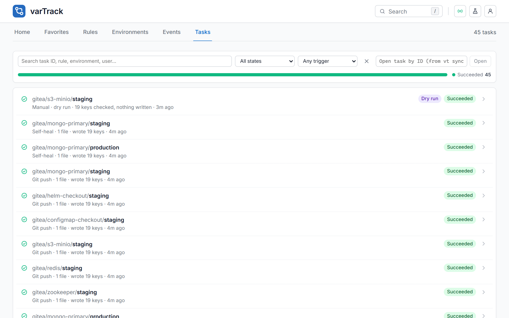

# varTrack

**GitOps-native configuration sync.** Push a file to Git — VarTrack writes it to MongoDB, Redis, ZooKeeper, S3, ConfigMaps, Helm, or a Linux server automatically. If someone edits the database directly, VarTrack detects it and restores the correct state.

[](https://github.com/jarin-devoss/varTrack/actions/workflows/ci.yml)
[](https://codecov.io/gh/jarin-devoss/varTrack)
[](LICENSE)
[](https://hub.docker.com/u/jarin-devoss)

[Quick Start](#quick-start) · [Try the demo](#try-it-in-one-command) · [CLI](cli/README.md) · [Config reference](#configuration-reference--configcue) · [Examples](examples/) · [**Documentation**](https://jarin-devoss.github.io/varTrack/)

---

## What it does

You commit a config file to Git. VarTrack reads it and writes the values to every configured sink:

```yaml
# configs/app.yaml — lives in your Git repo
database_host: mongo.prod.internal
feature_flag_dark_mode: true
max_connections: 50
```

Push to `main` → VarTrack automatically syncs to all configured sinks:

```
MongoDB        → collection "production-config"
Redis          → hash "production:cfg"
S3             → key prefix acme/production/
Kubernetes     → ConfigMap "myapp-production"
Helm           → release values "app-production"
Linux server   → /etc/app/production.env
ZooKeeper      → znodes under /acme/production/
```

Branch `develop` maps to `staging`, PR #42 maps to `pr-42` — each environment is isolated in every sink automatically.

---

## Try it in one command

The fastest way to see VarTrack in action is the demo. It starts a local Git server, MongoDB, ZooKeeper, Redis, and all three VarTrack services pre-configured, seeds a config repository and syncs it:

```bash
cd demo
docker compose up
```

Open http://localhost:8080 and sign in with Gitea as `demo-admin` / `VarTrack123`. Push a config change to the local repo and watch it sync automatically; [demo/README.md](demo/README.md) has a short tour (a change in Git, a value changed behind VarTrack's back and healed, a dry run, a prune).

---

## Why VarTrack?

Git is a good home for application configuration, but the values your applications read at runtime live in datastores — MongoDB documents, Redis hashes, ZooKeeper znodes, S3 objects, Linux `.env` files — and nothing keeps them in step with Git.

VarTrack fills that gap. It treats Git as the single source of truth for **application configuration data**, and writes it to the datastores your applications actually read.

| | VarTrack |
|---|---|
| Target | MongoDB, Redis, ZooKeeper, S3, ConfigMap, Helm, Linux |
| Drift detection | Any datasource |
| Secret management | HashiCorp Vault + `@secret()` annotations |
| Schema validation | CUE per tenant, enforced before every write |

It works alongside whatever deploys your services: VarTrack only keeps their runtime config in sync.

**VarTrack is the right fit if you:**

- Store config, feature flags, or environment variables in any combination of MongoDB, Redis, S3, ZooKeeper, Kubernetes, Helm, or Linux servers — and want Git to be the single authority
- Have multiple environments (dev, staging, production) and want changes to flow automatically on push
- Need one push to fan out to multiple sinks at once — write to a ConfigMap, a Helm release, and an S3 object in parallel
- Want drift detection — if someone edits a value directly in any sink, VarTrack restores the correct state automatically
- Need secrets to stay in Vault and never touch Git — `@secret()` annotations resolve at sync time

---

## Features

### Sync
- **7 sink types** — MongoDB, Redis, ZooKeeper, S3, Kubernetes ConfigMap, Helm, Linux server (SSH)
- **7 config formats** — YAML, JSON, TOML, .env, INI, HCL, XML — format auto-detected from file extension
- **Multi-sink fan-out** — one push writes to multiple sinks in parallel from one rule set
- **Sync strategies** — `AUTO` (by file size), `GIT_UPSERT_ALL` (write every key) and `GIT_SMART_REPAIR` (write only what differs from what the sink holds)
- **Stale key pruning** — once per environment, after all its files are written, delete the keys varTrack wrote before that Git no longer holds; `prune.protection` globs keep keys that must never go, and a key changed outside varTrack is kept and reported

### Routing & environments
- **`destination_template`** — control exactly where data lands per rule using `{tenant}` and `{env}` placeholders
- **Environment resolution** — map branch names, PR numbers, tags, or file paths to environment names
- **Layered rules** — `config.cue` → the tenant's `bundle.json` → a repository's `vartrack.json` → `force`; each layer overrides the one before, keys only `config.cue` sets stay out of the lower layers, and shared settings come in with `extends` presets
- **GitHub and Gitea** — webhooks, sign-in and repository permissions for both (GitHub Enterprise and self-hosted Gitea included); another platform is a gateway driver away

### Validation & safety
- **CUE schema validation** — validate every payload against a per-tenant schema before any write
- **Dry-run mode** — simulate any sync without touching a datasource (the UI's Dry run, `vt sync --dry-run`); it reports the keys a prune would delete
- **`@secret()` annotations** — resolve Vault secrets into config values at ETL time; values masked as `***` in dry-run reports
- **`@logger()` annotations** — emit structured change-log entries when specific fields change value

### Drift detection
- **Drift detection** — watcher-service polls continuously; the orchestrator reads the sinks and compares them, key by key, with what it last synced from Git. `suspend` pauses a rule, `drift_ignore` lists keys the application changes itself
- **Self-heal** — set `self_heal: true` on a rule and VarTrack restores correct state automatically on drift
- **Leader election** — ZooKeeper or Redis distributed lock keeps multi-replica watchers in sync

### Operations
- **CLI (`vt`)** — push any local file directly from terminal or CI/CD without a Git push; `vt validate-config` checks a `vartrack.json` or `bundle.json` before it is pushed
- **Git-permission auth** — the CLI API asks the rule's Git platform what the caller's own token may do (push syncs, read validates and dry-runs); an optional OPA policy adds per-env, per-datasource rules
- **Web UI with Git sign-in** — every tenant at once, each user seeing the rules their Git account can read
- **Observability** — OpenTelemetry traces, Prometheus metrics, and structured logs with optional ELK shipping on every service

---

## How it works



1. You push a config file to Git.
2. The **gateway-service** (Go) receives the webhook, verifies the HMAC signature, and forwards it via gRPC.
3. The **orchestrator-service** (Python) fetches the file from Git, validates it against a CUE schema, reads out the environment being synced, flattens it, compares it with each sink, and writes to all configured sinks.
4. The **watcher-service** (Go) asks the orchestrator, on a configurable interval, whether each datasource still matches Git; the orchestrator reads the sinks back and compares. When a value diverges, the watcher logs the delta and — if `self_heal: true` — has the orchestrator restore correct state.

| Service | Language | Role |
|---|---|---|
| **gateway-service** | Go | Webhook receiver, platform routing, gRPC forwarder |
| **orchestrator-service** | Python | ETL pipeline, CUE validation, multi-sink writer |
| **watcher-service** | Go | Drift detection, self-heal trigger |
| **vt** | Go | CLI for manual sync and CI/CD integration |

---

## Where configuration lives

A rule is built from up to three files, each owned by a different team and kept in a different place. Each layer overrides the one before it; `config.cue`'s `force` block is applied last.

| File | Lives in | Edited by | Holds |
|---|---|---|---|
| `config.cue` | the varTrack hosts (`CONFIG_PATH`), read by every service | the team that runs varTrack | platforms, datasources and their credentials, the rules, `force` |
| `bundle.json` | the root of a tenant's schema repository, next to its CUE schemas | the tenant | the tenant's settings for the rules `config.cue` defines |
| `vartrack.json` | the pushed config repository (`vartrack.json`, or under `.github/`, `.gitea/`, `.gitlab/`), read at the pushed commit | the repository's owners | the repository's overrides: `branch_map`, `root_key`, `prune`, `sync_mode`, … |

Which file may set which option is generated from `proto/vartrack/v1/models/rule.proto` into the [Rule options](docs/configuration/rule-options.md) reference; [Configuration files](docs/configuration/index.md) walks through an example of the three files and the rule they make. `vt validate-config` checks a `vartrack.json` or `bundle.json` before it is pushed.

---

## Quick Start

**To try it,** run the demo above: one command, nothing else to install.

**Against your own repositories, with Docker Compose:**

```bash
git clone https://github.com/jarin-devoss/vartrack
cd vartrack
cp .env.example .env          # fill in MONGO_ROOT_PASSWORD at minimum
# write your config.cue (see Where configuration lives above)
docker compose up -d
```

Register a webhook in your GitHub or Gitea repository pointing to `http://your-server:5657/webhooks/mongo` and push a config file: varTrack syncs it. The [Docker Compose guide](docs/deployment/docker-compose.md) has the full walkthrough, the `.env` reference and scaling.

**From source:** [Getting started, Option B](docs/getting-started.md#option-b--build-from-source). `.gitattributes` keeps the `.proto` files LF on every OS, so `buf generate` gives the same Go code on Windows and Linux; a checkout made before that needs `rm -rf proto && git checkout -- proto`.

---

## A look at the web UI

Rules, environments, drift, sync history and dry runs, signed in with your Git account. It runs on port 8080 with Docker Compose, or `cd ui && npm install && npm run dev` for http://localhost:5173 ([UI README](ui/README.md)).

| | |
|---|---|
|  |  |
| What needs attention first | Each rule, its desired state in Git and what its sink holds |
|  |  |
| Drift, key by key | Every sync and what started it |

---

## Learn more

The documentation is in [`docs/`](docs/index.md), published with MkDocs.

| To know | Read |
|---|---|
| Where data lands in each sink (`destination_template`) | [Destination template](docs/concepts/destination-template.md) |
| How a branch, a pull request or a tag becomes an environment | [Environment resolution](docs/concepts/environment-resolution.md) |
| `AUTO`, `GIT_UPSERT_ALL`, `GIT_SMART_REPAIR`, and prune | [Sync strategies](docs/concepts/sync-strategies.md) |
| How drift is found and healed, and leader election for several watchers | [Drift detection](docs/concepts/drift-detection.md) |
| One file into several sinks, PR environments, Vault, a whole `config.cue` | [Examples](docs/examples/index.md), [`examples/bundles/`](examples/bundles/) |
| Every key of `config.cue` | [config.cue reference](docs/configuration/bundle.md) |
| The file formats varTrack reads and writes | [File formats](docs/configuration/formats.md) |
| `vt`, and syncing or validating from CI | [vt commands](docs/cli/index.md), [CI/CD integration](docs/cli/cicd.md) |
| Every endpoint and the credential it needs | [HTTP and gRPC API](docs/reference/http-api.md) |
| Running it in production | [Production checklist](docs/operations/production-checklist.md), [High availability](docs/operations/high-availability.md), [Monitoring](docs/operations/monitoring.md) |

---

## Testing

Before a push, run what CI checks first, in a scratch copy of your last commit (it changes nothing in your checkout):

```bash
sh scripts/check-before-push.sh           # every check, about 150 s here
sh scripts/check-before-push.sh --quick   # the three consistency checks without the tests, about 25 s
```

It regenerates the protobuf stubs and fails when `libs/go/gen` differs (the stubs are checked in), installs the UI from
`package-lock.json` with `npm ci` into a clean folder (a `package.json` that names a package the lock lacks fails here, not
in CI), runs `go mod tidy` in each Go module, and then the orchestrator, Go and UI tests. It needs `buf`, Go, Node and
Python with the orchestrator's test dependencies, and says which one is missing. A file you forgot to commit is not in the
scratch copy, so commit first. `--help` lists the options.

The same tests, one package at a time:

```bash
# shared Go module (generated code, bundle loader)
cd libs/go && go test ./...

# gateway-service
cd gateway-service && go test ./...

# watcher-service
cd watcher-service && go test ./...

# cli
cd cli && go test ./...

# orchestrator-service
cd orchestrator-service
pip install -e ".[test]"
pytest tests/

# web UI
cd ui && npm install && npm run typecheck && npm test

# End-to-end (Docker Compose)
cd e2e && docker compose up
```

---

## Docker

```bash
docker build -t jarin-devoss/gateway-service:latest      --file ./gateway-service/Dockerfile .
docker build -t jarin-devoss/orchestrator-service:latest --file ./orchestrator-service/docker/Dockerfile .
docker build -t jarin-devoss/watcher-service:latest      --file ./watcher-service/Dockerfile .
```

All three build from the repository root: the gateway and the watcher use the shared Go module in `libs/go`, and the orchestrator image generates its Python gRPC stubs from `proto/` in its own build stage, so an image does not depend on a `buf generate` run in the checkout.

Pre-built multi-arch images (`linux/amd64`, `linux/arm64`) are published on every tagged release:

```bash
docker pull jarin-devoss/gateway-service:latest
docker pull jarin-devoss/orchestrator-service:latest
docker pull jarin-devoss/watcher-service:latest
```

---

## Repository layout

```
varTrack/
├── proto/                        # Protobuf definitions
├── buf.gen.yaml                  # Buf code-generation config (one template)
├── docs/                         # The documentation site (MkDocs)
├── scripts/                      # check-before-push.sh: what CI checks, before a push
├── libs/go/                      # Go — generated code, bundle loader, secret files (shared)
│
├── gateway-service/              # Go — HTTP ingress, webhook receiver, CLI API
├── orchestrator-service/         # Python — ETL pipeline, sink writer
├── watcher-service/              # Go — drift detection, self-heal
├── cli/                          # Go — vt command-line tool
├── ui/                           # React — web UI
├── examples/                     # Example bundles and config files
├── demo/                         # A stack to try varTrack in: services, a Git server, a seeded config repo, a tour
└── e2e/                          # The regression suite, on a stack of its own
```

---

## Security

Webhook signatures (HMAC-SHA256), replay protection, rate limiting, and mTLS are enforced automatically in production (`APP_ENV=production`). See the [Production checklist](docs/operations/production-checklist.md) and [Internal authentication](docs/operations/internal-auth.md) for what to set, and what each setting protects.

---

## License

Apache License 2.0 — see [LICENSE](LICENSE).
