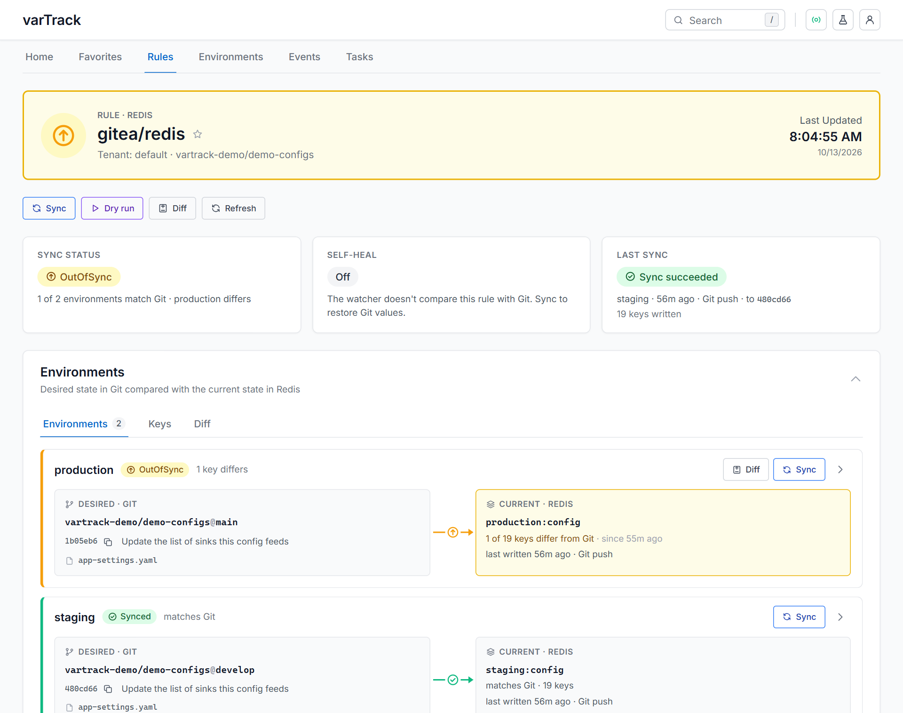
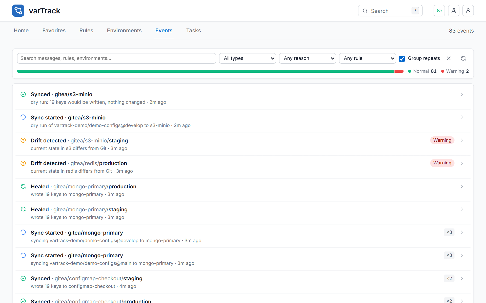

# Drift Detection & Self-Heal

For every rule with `self_heal: true`, the watcher-service asks the orchestrator on each poll whether the datasource still matches Git, and has it restore the ones that don't.

---

## What is drift?

Drift happens when a datasource value no longer matches what Git says it should be. Common causes:

- A developer edits MongoDB directly during an incident
- A deployment script overwrites a config value
- A Kubernetes operator changes a ConfigMap
- A Redis key expires or is flushed

Without drift detection, these changes go unnoticed until something breaks.

---

## How detection works

The orchestrator is the one component that reads and writes the sinks: it holds their credentials and their client code. So it also does the comparing. On every poll the watcher calls `CheckDatasource`; the orchestrator reads, in each synced environment, the keys varTrack wrote and compares them with what it last synced from Git (the sync ledger). The watcher itself reads no sink and holds no sink credentials.

```
Every POLL_INTERVAL (default: 60s), for each self_heal rule
  │
  └── CheckDatasource → the orchestrator reads the sink, key by key
        ├── in sync  → nothing to do
        ├── syncing  → a sync is still writing: look again on the next poll
        ├── unknown  → can't tell (never synced, sink unreadable): no heal
        └── drifted  → vartrack_watcher_drift_detected_total + 1
              └── Heal: SyncDatasource → the orchestrator re-syncs this
                  datasource from the head of every branch that feeds it
```

A few rules keep this from healing what it shouldn't, or waiting forever:

- **Unknown is not drift.** A sink that cannot be read answers *unknown*, never "every key is missing", so an outage does not set off heals. A value the sink never gives back — a Vercel *sensitive* variable — is neither missing nor changed.
- **One heal at a time.** After it asks for a heal, the watcher waits two poll intervals (at least 30 s) before asking again for the same drift, so the queued sync has time to start; a check that answers *in sync* ends the wait.
- **A failed heal** is tried again on the next poll; while heal requests keep failing, a circuit breaker stops sending them for a while.
- **A sync that died** — a worker killed mid-sync leaves no result. A sync still marked running after 15 minutes (Celery stops any task after 10) no longer counts, so the watcher heals instead of waiting on it.

---

## Enabling self-heal

Set `self_heal: true` on a rule to enable automatic repair:

```cue
rules: [{
  platform:   "github"
  datasource: "mongo"
  self_heal:  true    // watcher will restore state on drift
}]
```

The watcher asks the orchestrator which rules to watch on every poll, so a rule that gains `self_heal`, or is suspended or removed, is picked up at the next poll, without restarting the watcher. Rules with `self_heal: false` (or omitted) are not polled by the watcher, and nothing repairs them. The web UI still compares them with Git whenever it reads them, so their drift shows there until someone syncs from Git:



---

## Concrete example

Your config in Git:

```yaml
max_connections: 50
log_level: info
```

Someone runs `db.variables.updateOne({key: "max_connections"}, {$set: {value: 5}})` directly in MongoDB.

On the next poll cycle:

1. The watcher asks the orchestrator (`CheckDatasource`): Git says `50`, MongoDB has `5` — drifted
2. `self_heal: true` → it calls `SyncDatasource` on the orchestrator
3. The orchestrator fetches the file from Git, parses it, writes `max_connections = 50` back to MongoDB
4. The next check answers *in sync* — state restored

Had the change come from a push to Git, the sync of that push would have recorded it, step 1 would have answered *in sync*, and nothing would be healed.

Total recovery time: up to one `POLL_INTERVAL` (default 60 seconds).

On the web UI's Events page a repair shows as **Healed**. Drift on rules without self-heal shows as **Drift detected** and stays until someone syncs:



---

## Metrics

Monitor drift in Prometheus / Grafana:

| Metric | Type | Description |
|---|---|---|
| `vartrack_watcher_drift_detected_total` | Counter | Drift found, by rule |
| `vartrack_watcher_heal_triggered_total` | Counter | Heals the orchestrator accepted |
| `vartrack_watcher_heal_failed_total` | Counter | Heals that could not be requested |
| `vartrack_watcher_poll_duration_seconds` | Histogram | How long a `CheckDatasource` took |
| `vartrack_watcher_up` | Gauge | 1 while a rule's loop runs |

---

## Poll interval

Adjust how often the watcher checks each datasource:

```bash
POLL_INTERVAL=30s go run ./watcher-service/cmd
```

Lower values mean faster drift detection but more load on the orchestrator, which reads every self-heal datasource each poll.

---

## Why polling? (and how it's kept efficient)

varTrack uses a **scheduled pull model** rather than event-driven push because it must support eight fundamentally different backends — MongoDB, Redis, ZooKeeper, S3, Kubernetes ConfigMaps, Helm, Vercel, and Linux servers. Each backend exposes a different (or no) change-notification mechanism:

| Datasource | Native change events? |
|---|---|
| MongoDB | Change Streams (replica set only) |
| Redis | Keyspace notifications (off by default, extra config) |
| ZooKeeper | Watches (per-znode, limited concurrency) |
| S3 | Event notifications (requires SNS/SQS wiring) |
| Linux server | None — SSH file stat only |
| Vercel | None |
| ConfigMap | Kubernetes informer (requires in-cluster) |
| Helm | None — release state only |

A unified polling model means a single code path works across all backends with no external infrastructure requirements.

**How the overhead is minimised:**

- **Lightweight reads** — the orchestrator reads only the keys varTrack wrote in each environment, not the entire datasource, and reads the environments of a datasource in parallel.
- **Configurable interval** — default 60 s; set `POLL_INTERVAL` to match your SLA.
- **Leader election** — in multi-replica deployments, only one replica polls (ZooKeeper or Redis distributed lock).
- **Circuit breaker** — while heal requests keep failing, the watcher stops sending them for a while.

---

## Multi-replica deployments

When running multiple watcher replicas, only one should poll and heal at a time. Leader election ensures this:

```cue
bundle: {
  watcher_leader_election_datasource: "redis"   // or "zookeeper"
}
```

This is the only thing the watcher reads `config.cue` for. The datasource is one of the bundle's `datasources`, named like the others (`redis`, or `redis-broker` for the one tagged `broker`). Its password may be written inline or as a `{file: …}`; a `{ref: …}` is refused at startup, because the watcher has no secret manager.

Replicas that are not the leader stay idle. If the leader crashes, another replica acquires the lock within one TTL window (15 seconds for Redis).

The watcher keeps no state between polls: the orchestrator compares with its sync ledger. (`watcher_state_datasource` was removed; a `config.cue` that still sets it loads, with a log line.)
