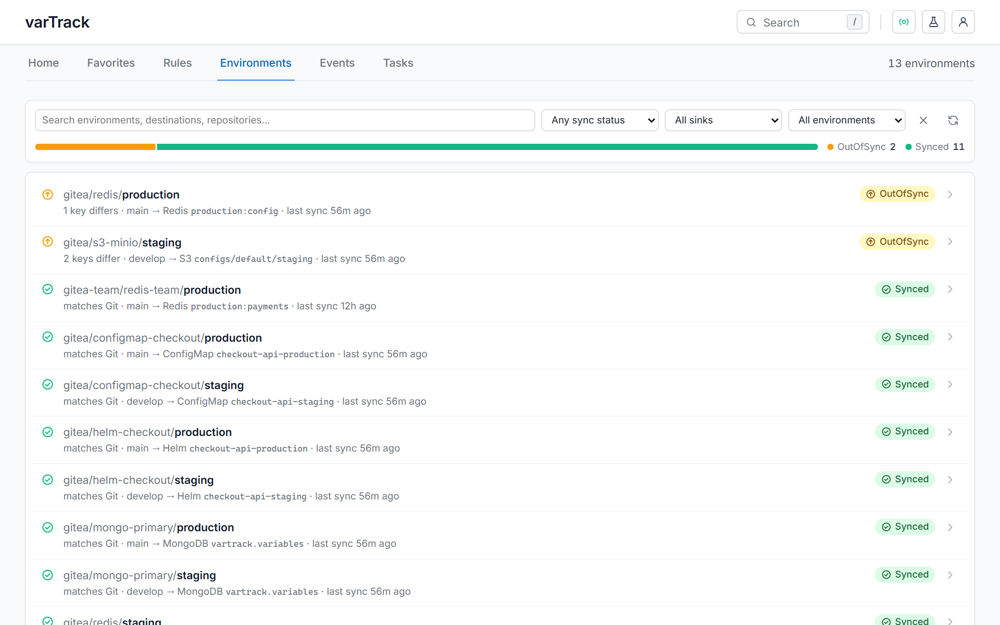

# Environment Resolution

When a webhook fires, varTrack resolves a single environment string from the event. This string is used to:

- Resolve `{env}` in `destination_template`
- Select the correct subtree from env-keyed config files
- Determine which sink collection, prefix, or path to write to

---

## Resolution order

varTrack tries each strategy in order and uses the first one that produces a match:

| Priority | Strategy | Example |
|---|---|---|
| 1 | `branch_map[branch]` | `main` → `production` |
| 2 | `file_path_map` | `production` → `configs/prod.yaml` |
| 3 | `pr_as_env: true` | PR #42 → `pr-42` |
| 4 | `branch_as_env: true` | branch `develop` → `develop` |
| 5 | `tag_as_env: true` | tag `v1.2.3` → `v1.2.3` |
| 6 | none | the push feeds no environment of the rule: it is **skipped** |

There is **no `default` environment**. A push that none of the strategies places feeds nothing of the rule, so it is skipped: the task ends *Succeeded · nothing to do* and says so (`branch feature/x feeds no environment of gitea/redis-hash`), and nothing is written to an environment nobody declared. `vt sync --env X` to an environment the rule does not produce is refused the same way (`nothing feeds X in the … rule`).

### A rule must name its environments

A rule has to say where its environments come from: `branch_map`, `file_path_map`, `branch_as_env`, `pr_as_env` or `tag_as_env`, **in `config.cue` or the tenant's `bundle.json`** (a repository's `vartrack.json` may add to them, but cannot be the only place). A rule that names none is **refused** when it is loaded (so is a rule that names no file to read: it needs `file_name` or `file_path_map` in the same two places): nothing runs it, the Rules page lists it as *Refused* with the reason, an event (`RuleRefused`) says so, `vt validate` reports it for a `bundle.json`, and the rest of the bundle loads.

To keep writing to an environment called `default`, map a branch to it. The environment, its destinations and its data are the same as before:

```cue
branch_map: {main: "default"}
```

`default` is then an ordinary name: when the `branch_map` stops mapping it, it is a leftover like any other ("No longer synced by this rule": not compared with Git, its Diff, Sync and Dry run disabled, **Forget** to drop it).

`pr_as_env`, `branch_as_env` and `tag_as_env` used to be called `env_as_pr`, `env_as_branch` and `env_as_tags` (the S3 option `prefix_as_env` was `env_as_prefix`, and ZooKeeper's `zk_path_template` is now `destination_template`). The old names still work in `config.cue`, `bundle.json` and `vartrack.json`; varTrack logs a warning with the new name.

---

## `branch_map` — explicit mapping

Map specific branch names to environment names:

```cue
rules: [{
  platform:   "github"
  datasource: "mongo"
  file_name: "app-settings.yaml"
  branch_map: {
    main:    "production"
    develop: "staging"
    qa:      "qa"
  }
}]
```

Pushes to `main` write to `production-config`. Pushes to `develop` write to `staging-config`. Any branch not in the map falls through to the next strategy.

The web UI's Environments page lists every resolved environment with the branch it comes from and where it is written:



---

## `file_path_map` — one file per environment

Map each environment to the file that holds its settings, as `{env: path}`:

```cue
rules: [{
  platform:   "github"
  datasource: "mongo"
  file_path_map: {
    production: "configs/production.yaml"
    staging:    "configs/staging.yaml"
  }
}]
```

A push that changes `configs/production.yaml` resolves to `production`. The path is the file's exact
path in the repository, not a pattern. The same map says which file to read for an environment when a
sync is started by hand (`vt sync --revision`, the web UI's *Sync*). A map written the other way round,
`{path: env}`, is not read that way: the log says so, and the push resolves by the rules below it.

---

## `pr_as_env` — PR environments

```cue
pr_as_env: true
```

Pull request events resolve to `pr-{number}`. Useful for ephemeral preview environments.

```
PR #42  → env = "pr-42"
PR #103 → env = "pr-103"
```

---

## `branch_as_env` — branch name as environment

```cue
branch_as_env: true
```

The branch name becomes the environment name directly:

```
branch "develop"     → env = "develop"
branch "feature/foo" → env = "feature/foo"
```

---

## `tag_as_env` — tag name as environment

```cue
tag_as_env: true
```

Tag push events use the tag name as the environment:

```
tag "v1.2.3"    → env = "v1.2.3"
tag "release-5" → env = "release-5"
```

---

## `root_key` — extracting a subtree before slicing

If your config file has a wrapper key, set `root_key` in the rule to unwrap it first. varTrack extracts the subtree under that key, then reads the environments in it ([below](#several-environments-in-one-file)).

```cue
rules: [{
  root_key: "vartrack"   // default — extract the "vartrack" subtree if it exists
}]
```

```yaml
# configs/app.yaml
vartrack:
  production:
    database_host: mongo.prod.internal
  staging:
    database_host: mongo.staging.internal
other_tool:
  setting: ignored      # not under root_key — never touched
```

`root_key: "vartrack"` → extracts the inner dict → its environment objects are read → `database_host=mongo.prod.internal` for `production`.

Set `root_key: ""` to always process the whole file regardless of structure.

If the key is the default, `vartrack`, and the file does not have it, varTrack uses the whole file. A `root_key` the rule sets to anything else that the file does not have **skips the file**: the log says `root_key=… not found in …, skipping`, and the task reports nothing to do.

---

## Several environments in one file

When one config file holds the settings of more than one environment, varTrack reads out the one being synced. **Which names are environments is not guessed from the file: it is what the rule declares**, plus the environment being synced and `default`:

| The rule names environments with | The names a file may use for them |
|---|---|
| `branch_map` | its values (`production`, `staging`), not the branch names |
| `file_path_map` | its keys |
| `branch_as_env` | every branch of the repository |
| `tag_as_env` | every tag of the repository |
| `pr_as_env` | `pr-<number>` |

"The rule" is the rule a sync runs with: `config.cue`, then the tenant's `bundle.json`, then the repository's `vartrack.json` at the pushed commit, then `force`. A `vartrack.json` that adds a `branch_map` entry adds an environment. The branches and tags are read from the copy of the repository varTrack already holds; no call goes to the Git server.

Two rules read the file.

### At the root: environment objects, and a base

The keys at the root that are environments (an object under a name the rule declares, or `default`) are **environment objects**. Every other key is the **base**: settings every environment shares. An environment gets the base, then `default`, then its own object, each laid over the one before:

```json
{
  "default":    { "db": { "host": "db.internal", "port": 5432 } },
  "production": { "db": { "host": "db.prod.internal" } }
}
```

| env | result |
|---|---|
| `production` | `db.host=db.prod.internal`, `db.port=5432` |
| `staging` (no object of its own) | `db.host=db.internal`, `db.port=5432` (from `default`) |

The merge goes **key by key, at every depth**: `production` changed `db.host` and kept `db.port`. A list, a number, a string or `null` in the environment replaces what `default` has; lists are never joined.

Settings that belong to no environment sit next to the environment objects, and an object may override them:

```json
{
  "timeout_ms": 3000,
  "default":    { "db": "db.internal" },
  "production": { "db": "db.prod.internal", "timeout_ms": 1500 }
}
```

| env | result |
|---|---|
| `production` | `db=db.prod.internal`, `timeout_ms=1500` |
| `staging` | `db=db.internal`, `timeout_ms=3000` |

A root made only of objects, one of them `default` or the environment, is keyed by environment whatever its names: the key of a branch deleted since is an environment object nobody reads, never base settings written into every environment.

### Under the root: one value per environment

An object whose keys are all `default` or environments is **one value per environment**, at any depth and inside lists:

```json
{
  "replicas": { "default": 2, "production": 6 },
  "db": { "host": { "default": "db.internal", "production": "db.prod.internal" } }
}
```

| env | result |
|---|---|
| `production` | `replicas=6`, `db.host=db.prod.internal` |
| `staging` | `replicas=2`, `db.host=db.internal` |

An object that has `default` **and a key that is not an environment** is not a value per environment. It is written whole:

```json
{ "timeouts": { "default": 30, "upload": 300 } }
```

Every environment gets `timeouts.default=30` and `timeouts.upload=300`.

### An environment the file does not name

| The file has | `qa`, which the file does not name, gets |
|---|---|
| a `default` | `default`'s settings |
| settings of no environment, and no `default` | those settings only |
| neither | **nothing**: the file is skipped for `qa`. The task ends *nothing to do* and says why (`app-settings.json names no environment 'qa' and no 'default'`). With [`strict_validation`](../configuration/rule-options.md#strict_validation) the file fails with the same words. |

The settings of another environment are never written under `qa`.

### `default` fallback

This `default` is a key inside the file, not an environment: which environment a push feeds is decided above, and there is no `default` environment. (`branch_map: {main: "default"}` makes an environment of that name, and the file's `default` is then its own.)

### With `root_key`

`root_key` is read first, so the environments can sit inside a block of a file owned by other tooling. Use it to extract only the varTrack-relevant subtree before the environments are read.

```cue
rules: [{
  root_key: "vartrack"   // default — extract "vartrack" subtree if present
}]
```

A `package.json` that also carries deploy config:

```json
{
  "name": "my-app",
  "version": "1.0.0",
  "scripts": { "start": "node index.js" },
  "vartrack": {
    "production": { "API_URL": "https://api.prod.com",  "LOG_LEVEL": "warn"  },
    "staging":    { "API_URL": "https://api.stg.com",   "LOG_LEVEL": "info"  },
    "default":    { "API_URL": "https://api.local.com", "LOG_LEVEL": "debug" }
  }
}
```

```cue
rules: [{
  file_name: "package.json"
  root_key:  "vartrack"       // ignore name/version/scripts — only sync vartrack block
  branch_map: { main: "production", develop: "staging" }
}]
```

Push to `main` → `API_URL=https://api.prod.com`, `LOG_LEVEL=warn` written to the sink.

### With `branch_as_env`

With `branch_as_env` the environments are the repository's branches, so a file can key its settings by branch name, `feature/login` included:

```json
{
  "default": { "replicas": 1 },
  "main":    { "replicas": 6 }
}
```

Push to `main` → `replicas=6`; a push to any other branch, `e2e-feature` say → `replicas=1`.

---

## Combining strategies

Strategies can be combined. varTrack uses the first one that matches:

```cue
rules: [{
  platform:   "github"
  datasource: "mongo"
  file_name: "app-settings.yaml"
  branch_map: {
    main:    "production"   // explicit — highest priority
    develop: "staging"
  }
  pr_as_env:     true       // fallback for PRs not in branch_map
  branch_as_env: true       // fallback for all other branches
}]
```

| Event | Resolved env |
|---|---|
| Push to `main` | `production` (from `branch_map`) |
| Push to `develop` | `staging` (from `branch_map`) |
| PR #42 opened | `pr-42` (from `pr_as_env`) |
| Push to `feature/x` | `feature/x` (from `branch_as_env`) |
