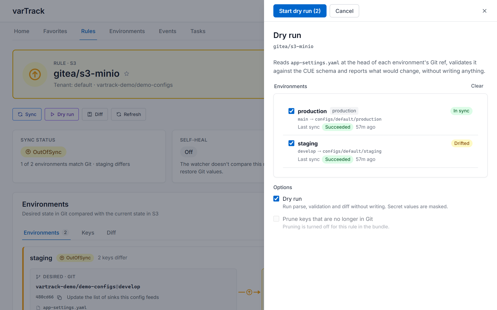

# Sync Strategies

A sync strategy controls how varTrack applies the flattened config values to a datasource. The right strategy depends on the size of your config and how often you need reads vs. writes.

---

## Strategies

=== "AUTO (recommended)"

    varTrack picks the strategy automatically based on payload size:

    - ≤ 500 keys → `GIT_UPSERT_ALL`
    - > 500 keys → `GIT_SMART_REPAIR`

    This is the default and works well for most configurations. No tuning needed.

    ```cue
    sync_mode: "AUTO"
    ```

=== "GIT_UPSERT_ALL"

    Writes every key from the flattened Git payload to the datasource in one bulk operation. Does not read the current state first.

    **Best for:** Small configs (< 500 keys), initial bootstrapping, or when you always want a clean overwrite.

    ```cue
    sync_mode: "SYNC_MODE_GIT_UPSERT_ALL"
    ```

    | | |
    |---|---|
    | Read before write | No |
    | Keys written | All |
    | Stale key cleanup | Only if `prune: true` set |
    | Best for | Small configs |

=== "GIT_SMART_REPAIR"

    Reads the current live state first, computes a diff (added / changed / removed keys), and writes only the differences. Uses BLAKE3 content hashing to detect unchanged values.

    **Best for:** Large configs (> 500 keys), or datasources where minimizing write operations matters.

    ```cue
    sync_mode: "SYNC_MODE_GIT_SMART_REPAIR"
    ```

    | | |
    |---|---|
    | Read before write | Yes |
    | Keys written | Changed only |
    | Stale key cleanup | Yes, on diff |
    | Best for | Large configs |

=== "LIVE_STATE"

    Replaces the entire stored state with Git's current view. No diff computed — direct overwrite.

    **Best for:** Low-latency sinks, or scenarios where the simplest possible write path matters more than efficiency.

    ```cue
    sync_mode: "SYNC_MODE_LIVE_STATE"
    ```

---

## Setting the strategy

Override per rule in `config.cue`:

```cue
rules: [{
  platform:   "github"
  datasource: "mongo"
  sync_mode:  "SYNC_MODE_GIT_SMART_REPAIR"
}]
```

Or let `AUTO` decide — just omit `sync_mode` or set it to `"AUTO"`.

Each mode can be written short (`"AUTO"`, `"GIT_SMART_REPAIR"`) or as its full proto name (`"SYNC_MODE_AUTO"`, `"SYNC_MODE_GIT_SMART_REPAIR"`); both load.

---

## Stale key pruning

When keys are removed from your Git config file, varTrack can delete them from the datasource:

```cue
rules: [{
  platform:   "github"
  datasource: "mongo"
  sync_mode:  "AUTO"
  prune:      true     // delete keys present in datasource but missing from Git
}]
```

!!! warning
    `prune: true` permanently deletes keys from the datasource that are no longer in Git. Use `prune: {enabled: true, dry_run: true}` or the full dry-run first to verify what would be removed.

### What prune deletes

Prune runs **once per environment, after all of its files are written**, and only if none of them failed. So a key that moved from one file to another is never deleted, and there is nothing to configure for multi-file rules.

A key is stale when varTrack wrote it before and no file of the environment holds it any more. Prune deletes nothing else:

- A key somebody else put in the datasource is never deleted, with or without `protection`.
- A stale key that was **changed outside varTrack** since varTrack wrote it is kept, and reported with a `PruneSkipped` event.
- Environments that write to the same place keep each other's keys: Vercel's `staging` and `develop` both write to `preview`, and a Redis `key_prefix` or a ZooKeeper path without `{env}` is shared by every environment.
- **So do datasources and tenants.** A datasource's name says nothing about where it writes. Two datasources on the same Redis database (same servers and `db`) with the same `key_prefix` and hash, the same ZooKeeper servers and root path, or the same Vercel team, project and targets write the same keys, and one never prunes a key the other still holds. A datasource on another server, or with another prefix, is not compared. MongoDB filters its documents by tenant, datasource and environment, so its datasources never share keys.
- If the rules of the tenants cannot be listed when prune runs, nothing is pruned, as when the ledger cannot be read.
- If the delete fails, the sync still succeeds. The keys stay on the list and the next sync retries them (a `PruneFailed` event).

Prune applies to sinks that keep each key separately: Redis (hash or strings), Vercel, ZooKeeper and MongoDB with `update_strategy: "STRATEGY_KEY_VALUE"`. A sink that replaces a whole object on every write — ConfigMap, S3, Linux server, Helm, MongoDB with its default `STRATEGY_DOCUMENT` (or `STRATEGY_FILE`), Redis with the JSON structure — has no stale key to delete. Setting `prune` on one has no effect.

`prune.last` was removed: the delete is always last now. A `prune` block that only had `last` is a disabled block; write `prune: true` or `prune: {enabled: true}`.

### `prune.protection`

Glob patterns for keys that must **never** be deleted, even if they're absent from Git. A pattern is matched against the flat key, like `db.host`, before the sink formats it for its own layout:

```cue
rules: [{
  prune: {
    enabled:    true
    protection: ["SYSTEM_*", "_vt_*", "readonly.*"]
  }
}]
```

`prune_protection`, the former flat name, is still read from `bundle.json` and `vartrack.json`; `config.cue` only takes the `prune` block.

---

## Dry-run

### Full dry-run — simulate the entire sync

No writes, no deletes. Returns a full report of what would be written, changed, and deleted. The keys prune would see as stale are listed per environment under `prune.would_delete`; whether something changed one outside varTrack is only known when a real sync reads it.

```bash
# Via CLI
vt sync --file configs/app.yaml --datasource mongo --env staging --dry-run

# Via HTTP
POST /v1/webhooks/mongo/dry-run
```

`@secret`-annotated fields are fetched from Vault but masked as `***` in the report.

In the web UI, **Dry run** on a rule runs the same simulation for the environments you pick:



### Prune dry-run — simulate deletes only

Test the prune step independently without touching any writes. Enabled per rule:

```cue
rules: [{
  prune: {
    enabled: true
    dry_run: true   // always simulate deletes — never actually remove keys
  }
}]
```

With `prune.dry_run`, every sync runs normally (writes go through) but the delete step is always simulated, never executed. The task reports the stale keys, and they stay on the list: turn `dry_run` off and the next sync deletes them.
