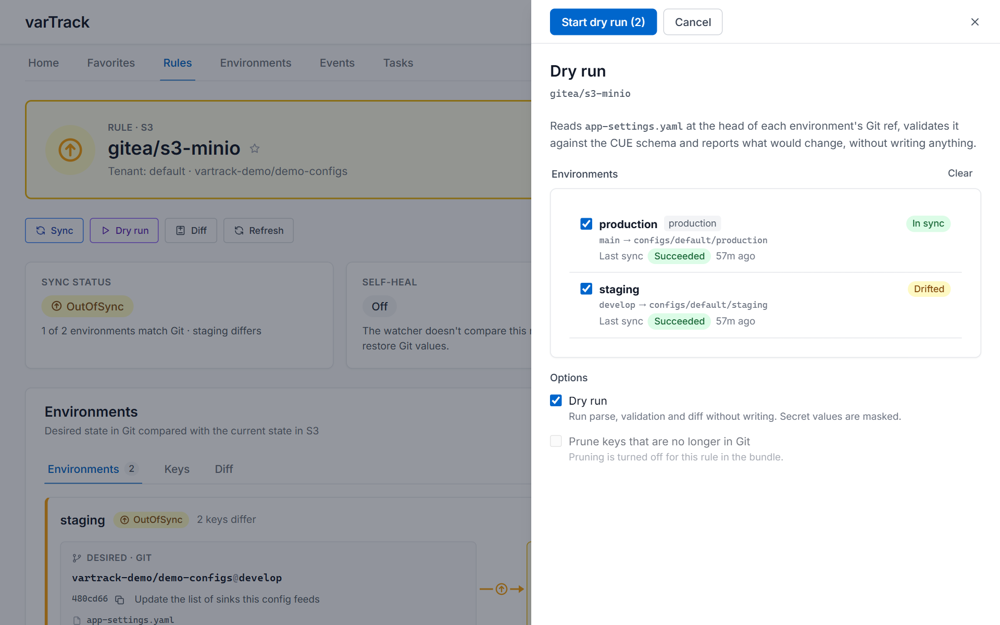

# Sync Strategies

A sync strategy controls how varTrack applies the flattened config values to a datasource. The right strategy depends on the size of your config and how often you need reads vs. writes.

---

## Strategies

=== "AUTO (recommended)"

    varTrack picks the strategy automatically based on payload size:

    - ≤ 500 keys → `GIT_UPSERT_ALL`
    - > 500 keys → `GIT_SMART_REPAIR`

    The size is the number of keys in one file.
    This is the default and works well for most configurations. No tuning needed.

    ```cue
    sync_mode: "AUTO"
    ```

=== "GIT_UPSERT_ALL"

    Writes every key from the flattened Git payload to the datasource, without reading what it holds first. (ZooKeeper is the one exception: a znode that already holds the value is not set again, so its version and its watches are left alone.)

    **Best for:** Small configs (< 500 keys), initial bootstrapping, or when you always want a clean overwrite.

    ```cue
    sync_mode: "SYNC_MODE_GIT_UPSERT_ALL"
    ```

    | | |
    |---|---|
    | Read before write | No |
    | Keys written | All |
    | Stale key cleanup | Only if `prune: true` set |
    | Best for | Small configs |

    Keys Git no longer holds are deleted only by [prune](#stale-key-pruning), in every mode.

=== "GIT_SMART_REPAIR"

    Reads what the datasource holds first and writes only what differs from Git. What is compared is the content the store holds now, not the commit that last wrote it, so a value someone changed directly in the store is written back.

    What "only what differs" means depends on how the sink stores the file:

    | Sink | Writes |
    |---|---|
    | Redis (hash or strings), ZooKeeper, MongoDB `STRATEGY_KEY_VALUE`, S3 with one object per key | only the keys whose value differs, and the sink's stamp; nothing at all when none does |
    | Redis `JSON`, MongoDB `STRATEGY_DOCUMENT` / `STRATEGY_FILE`, S3 `config.json`, a file on a Linux server, a ConfigMap, a Helm values file | the whole object, or nothing when it already holds exactly the file |
    | Helm release | one `helm upgrade`, or none (so no new release revision) when the release already holds the values |

    The task says what it left alone: *3 keys written, 812 unchanged*, or *nothing to change (812 keys already match Git)*. A sink that already holds the file keeps the stamp (commit, time) of the sync that wrote it.

    If the datasource cannot be read, every key is written, as `GIT_UPSERT_ALL` would, and the file's result says so (`sync_mode: GIT_UPSERT_ALL`, with the reason): a failed read never makes a write smaller.

    **Best for:** Large configs (> 500 keys), or datasources where minimizing write operations matters.

    ```cue
    sync_mode: "SYNC_MODE_GIT_SMART_REPAIR"
    ```

    | | |
    |---|---|
    | Read before write | Yes |
    | Keys written | Changed only (a whole object is written whole, or not at all) |
    | Stale key cleanup | Only if `prune: true` set |
    | Best for | Large configs |

---

## Setting the strategy

Override per rule in `config.cue`:

```cue
rules: [{
  platform:   "github"
  datasource: "mongo"
  file_name: "app-settings.yaml"
  branch_map: {main: "production"}
  sync_mode:  "SYNC_MODE_GIT_SMART_REPAIR"
}]
```

Or let `AUTO` decide — just omit `sync_mode` or set it to `"AUTO"`.

Each mode can be written short (`"AUTO"`, `"GIT_SMART_REPAIR"`) or as its full proto name (`"SYNC_MODE_AUTO"`, `"SYNC_MODE_GIT_SMART_REPAIR"`); both load.

Any other value is refused, never read as `AUTO`: in `config.cue` the services do not start, in a tenant's `bundle.json` the rule is listed as *Refused*, and in a repository's `vartrack.json` the sync fails. `vt validate-config` reports it before a push.

---

## Stale key pruning

When keys are removed from your Git config file, varTrack can delete them from the datasource:

```cue
rules: [{
  platform:   "github"
  datasource: "mongo"
  file_name: "app-settings.yaml"
  branch_map: {main: "production"}
  sync_mode:  "AUTO"
  prune:      true     // delete keys present in datasource but missing from Git
}]
```

!!! warning
    `prune: true` permanently deletes keys from the datasource that are no longer in Git. Run a dry run first (the UI's *Dry run*, `vt sync --dry-run`): it reports the keys a prune would delete.

### What prune deletes

Prune runs **once per environment, after all of its files are written**, and only if none of them failed. So a key that moved from one file to another is never deleted, and there is nothing to configure for multi-file rules.

A key is stale when varTrack wrote it before and no file of the environment holds it any more. Prune deletes nothing else:

- A key somebody else put in the datasource is never deleted, with or without `protection`.
- A stale key that was **changed outside varTrack** since varTrack wrote it is kept, and reported with a `PruneSkipped` event.
- Environments that write to the same place keep each other's keys: a Redis `key_prefix` or a ZooKeeper path without `{env}` is shared by every environment.
- **So do datasources and tenants.** A datasource's name says nothing about where it writes. Two datasources on the same Redis database (same servers and `db`) with the same `key_prefix` and hash, the same ZooKeeper servers and root path write the same keys, and one never prunes a key the other still holds. A datasource on another server, or with another prefix, is not compared. MongoDB filters its documents by tenant, datasource and environment, so its datasources never share keys.
  Who holds a key is recorded with each sync, as the key space the sync wrote to, so another tenant counts even when its schema repository cannot be read right now. A target last written by an older version has no such record and is placed by the rules until it is written again. When a prune finds another target holding keys in the same key space, the UI shows one **Shared key space** warning event for the environment (again after the sharing has ended and begun anew).
- If the rules of the tenants cannot be listed when prune runs, nothing is pruned, as when the ledger cannot be read.
- If the delete fails, the sync still succeeds. The keys stay on the list and the next sync retries them (a `PruneFailed` event).

Prune applies to sinks that keep each key separately: Redis (hash or strings), ZooKeeper and MongoDB with `update_strategy: "STRATEGY_KEY_VALUE"`. A sink that replaces a whole object on every write — ConfigMap, S3, Linux server, Helm, MongoDB with its default `STRATEGY_DOCUMENT` (or `STRATEGY_FILE`), Redis with the JSON structure — has no stale key to delete. Setting `prune` on one has no effect.

`prune.last` was removed: the delete is always last now. A `prune` block that only had `last` is a disabled block; write `prune: true` or `prune: {enabled: true}`.

### `prune.protection`

Glob patterns for keys that must **never** be deleted, even if they're absent from Git. A pattern is matched against the flat key, like `db.host`, before the sink formats it for its own layout:

```cue
rules: [{
  prune: {
    enabled:    true
    protection: ["SYSTEM_*", "_vt_*", "readonly.*"]
  }
}]
```

`prune_protection`, the former flat name, is still read from `bundle.json` and `vartrack.json`; `config.cue` only takes the `prune` block.

---

## Dry-run

### Full dry-run — simulate the entire sync

No writes, no deletes. Returns a full report of what would be written, changed, and deleted. The keys prune would see as stale are listed per environment under `prune.would_delete`; whether something changed one outside varTrack is only known when a real sync reads it.

```bash
# Via CLI
vt sync --file configs/app.yaml --datasource mongo --env staging --dry-run

# Via HTTP
POST /v1/webhooks/mongo/dry-run
```

`@secret`-annotated fields are fetched from Vault but masked as `***` in the report.

In the web UI, **Dry run** on a rule (or on one environment) runs the same simulation for the environments you pick. It is not a sync: the Sync panel stays open and shows its log — each task's stages, the files it read, what a sync would change and why a file was refused — and ends with a verdict:



### Prune dry-run — simulate deletes only

See what a prune would delete without deleting it by starting a dry run: the UI's *Dry run*, `vt sync --dry-run`, or the dry-run webhook. It runs the whole pipeline, writes nothing, and its report lists the stale keys per environment (`prune.would_delete`). The web UI's *Sync* panel shows the same list before a sync that prunes, and asks you to type `prune` only when a production-like environment would lose keys.

!!! note "`prune.dry_run` was removed"
    It made every sync of a rule report its prune instead of running it, with no way to see that from the person's side. A file that still sets it loads, and the loader warns; delete the line. A rule with `prune` off deletes nothing; a dry run reports what a prune would.
