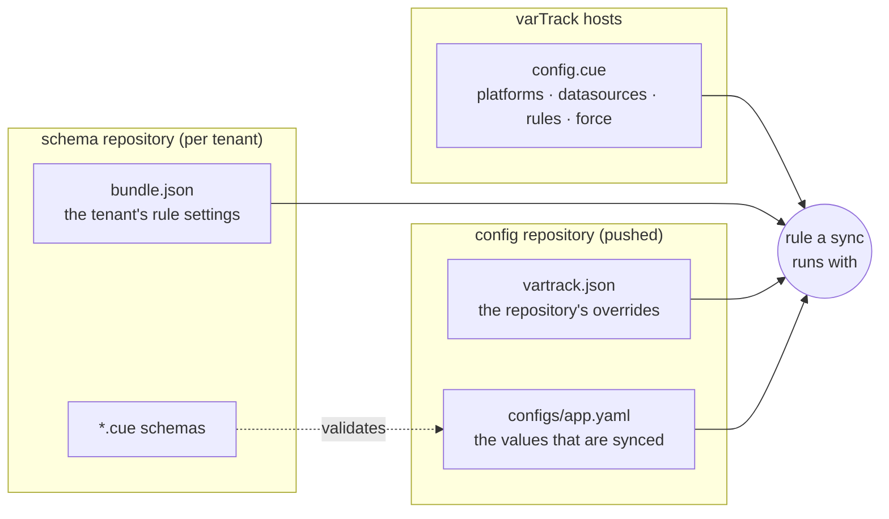

# Configuration files

varTrack is configured by a few files, each in a different place and owned by a different
team. This page says which file holds what, where it lives, who edits it, and how the
files combine into the rule a sync runs with.

---

## At a glance

| File | Lives in | Edited by | Read by | Picked up |
|---|---|---|---|---|
| [`config.cue`](bundle.md) | The hosts that run varTrack, at the path in `CONFIG_PATH`; every service mounts the same file | The team that runs varTrack | gateway, orchestrator, watcher | orchestrator: the next time it reads the file after it changed. gateway: when it starts, so restart it after changing platforms or rules. watcher: when it starts, for its leader election only — it gets the rules from the orchestrator |
| [`bundle.json`](schema-registry.md#bundlejson) (or `rules.json`) | The root of a tenant's **schema repository** | The tenant | orchestrator | First use, then every `SCHEMA_TTL_SECONDS` (300 s), and at once on a push to that repository |
| [CUE schemas](schema-registry.md) (`*.cue`) | The same schema repository | The tenant | orchestrator, before a file is written | As `bundle.json` |
| [`vartrack.json`](per-repo-overrides.md) | A **config repository** (the one that is pushed): `vartrack.json`, `.github/vartrack.json`, `.gitea/vartrack.json` or `.gitlab/vartrack.json`, the first found | The repository's owners | orchestrator | On every sync, at the pushed commit |
| [Presets](schema-registry.md#presets-extends) | Any repository a file names in `extends` | Whoever owns that repository | orchestrator | With the file that extends them |
| `SCHEMA_TENANT_<ID>_REPO` / `_BRANCH` / `_TOKEN` | The environment of the orchestrator API and its workers | The team that runs varTrack | orchestrator | When it starts |
| `~/.config/vt/config.yaml` | The machine that runs `vt` | Each user (`vt login`, `vt config`) | `vt` | On every command |



!!! note "One file per job"
    `config.cue` decides **what exists** — which platforms send pushes, which datasources
    can be written and how to reach them, which rules there are, and what no one else may
    change. `bundle.json` and `vartrack.json` only **adjust** those rules for a tenant and for
    a repository. Nothing in them repeats `config.cue`, so nothing has to be kept in step.

---

## How a rule is built

A sync looks up the rule for the push's platform and datasource and builds it in layers.
Each layer overrides the one before it, option by option:

1. **`config.cue`** — the rule as the team running varTrack wrote it.
2. **`bundle.json`** — the tenant's settings for the same platform and datasource.
3. **`vartrack.json`** — the pushed repository's settings, read at the pushed commit.
4. **`force`** — the `config.cue` rule's `force` block, applied last: what no tenant or
   repository may change.

A `bundle.json` or `vartrack.json` can pull in shared settings with
[`extends`](schema-registry.md#presets-extends). The presets are part of that file's layer:
they are resolved first, and the file's own settings go on top of them.

Every other option is replaced by the layer above it. Two kinds behave differently.

### Merged options

These combine key by key, so a layer adds to them instead of replacing them: a `bundle.json`
`branch_map` of `{develop: staging}` adds to `config.cue`'s `{main: production}`.
`prune.protection` patterns add up across layers — a layer can protect more keys, never fewer.

<!-- rule-options:mergeable -->
- [`branch_map`](rule-options.md#branch_map)
- [`file_path_map`](rule-options.md#file_path_map)
- [`prune`](rule-options.md#prune)
- [`variables_map`](rule-options.md#variables_map)
<!-- /rule-options:mergeable -->

### Options only `config.cue` sets

These decide which repositories a rule covers, where secrets come from and who may change
what, so a lower layer cannot change them. In `bundle.json` they are dropped with a warning;
in `vartrack.json` they are ignored and logged.

<!-- rule-options:admin-only -->
- [`exclude_repositories`](rule-options.md#exclude_repositories)
- [`force`](rule-options.md#force)
- [`overrides`](rule-options.md#overrides)
- [`repositories`](rule-options.md#repositories)
- [`secret_manager`](rule-options.md#secret_manager)
- [`self_heal`](rule-options.md#self_heal)
- [`tenants`](rule-options.md#tenants)
<!-- /rule-options:admin-only -->

A datasource's connection settings — its endpoint, database, bucket, host and credentials —
come only from its [datasource block](bundle.md#datasources) in `config.cue`.

Which option may be set in which file is listed for every option in the
[Rule options](rule-options.md) reference.

---

## An example: three files, one rule

=== "config.cue (varTrack hosts)"

    ```cue
    bundle: {
      platforms: [{github: {
        endpoint:        "https://github.com"
        push_event_name: "push"
        pr_event_name:   "pull_request"
        secret:          {file: "/run/secrets/github-webhook"}
      }}]
      datasources: [{mongo: {endpoint: "mongodb://mongo:27017", database: "vartrack"}}]
      rules: [{
        platform:     "github"
        datasource:   "mongo"
        repositories: ["acme/*"]
        file_name:    "configs/app.yaml"
        branch_map:   {main: "production"}
        self_heal:    true
        force:        {prune: {enabled: false}}   // production never prunes
      }]
    }
    ```

=== "bundle.json (acme/schemas)"

    ```json
    [
      {
        "platform":   "github",
        "datasource": "mongo",
        "branch_map": {"develop": "staging"},
        "root_key":   "vartrack",
        "self_heal":  false
      }
    ]
    ```

=== "vartrack.json (acme/payments)"

    ```json
    {
      "branch_map": {"release": "production"},
      "prune":      true
    }
    ```

A push to `acme/payments` syncs with:

| Option | Value | Why |
|---|---|---|
| `repositories` | `["acme/*"]` | `config.cue` |
| `file_name` | `configs/app.yaml` | `config.cue` |
| `branch_map` | `{main: production, develop: staging, release: production}` | merged from all three |
| `root_key` | `vartrack` | `bundle.json` |
| `self_heal` | `true` | `config.cue` only — the `bundle.json` value is dropped with a warning |
| `prune` | `{enabled: false}` | `vartrack.json` asked for `true`; `force` wins |
| connection | `mongodb://mongo:27017`, database `vartrack` | the `mongo` datasource in `config.cue` |

---

## Check a file before you push it

| File | Check | Where |
|---|---|---|
| `config.cue` | `vt bundle validate config.cue` locally; the gateway also refuses to start on a field the bundle does not have | your machine, CI |
| `bundle.json`, `vartrack.json` | `vt validate-config` — with no file named it checks the `vartrack.json` files of the current directory; exits 1 on errors or warnings, and with `--strict` also on renamed options | the config repository's CI ([example](../cli/cicd.md)) |
| A config file against its CUE schema | `vt validate --file configs/app.yaml --datasource mongo` | CI, before merging |

A file that cannot be used stops the sync instead of being half-applied: a `vartrack.json` that
is not valid JSON fails its sync, and a `bundle.json` that does not parse leaves the tenant
without rules until it is fixed (see [Presets](schema-registry.md#presets-extends)).

---

## Where to go next

- [Bundle reference](bundle.md) — every block of `config.cue`
- [Schema registry](schema-registry.md) — the schema repository, `bundle.json`, presets and tenants
- [Per-repo overrides](per-repo-overrides.md) — `vartrack.json`
- [Rule options](rule-options.md) — every rule option, and which file may set it
