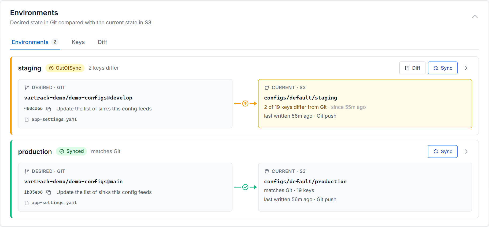

# Getting Started

Get varTrack running locally in under 10 minutes.

---

## Prerequisites

- Go 1.21+
- Python 3.11+
- A Celery broker — Redis or MongoDB (configured via `celery_broker_datasource` in the bundle)
- At least one configured sink
- [`buf` CLI](https://buf.build/docs/installation) — for proto code generation

---

## Option A — E2E demo (fastest)

No manual setup needed. Starts everything in Docker:

```bash
git clone https://github.com/jarin-devoss/varTrack
cd varTrack/e2e
docker compose up
```

This starts a local Git server, MongoDB, ZooKeeper, Redis, and all three varTrack services with a pre-configured bundle. Push any config change to the local repo and watch it sync.

### With more sinks and the web UI

`e2e/docker-compose.live.yml` adds S3 on MinIO and Kubernetes ConfigMaps and Helm releases on k3s, and seeds every sink through real Gitea pushes and webhooks:

```bash
buf generate          # the orchestrator image needs the Python gRPC stubs
cd e2e
docker compose -f docker-compose.yml -f docker-compose.live.yml up -d --build \
  gitea redis mongo zookeeper minio minio-init vault vault-init \
  k3s k3s-kubeconfig orchestrator-api orchestrator-worker gateway watcher live-seed

cd ../ui && npm install && npm run dev
```

Open the UI at http://localhost:5173. Two Git servers feed the demo, so sign-in covers two platforms: **gitea** (http://localhost:3000, the demo configs) and **gitea-team** (http://127.0.0.1:3001, a payments team with a private repository). Sign in with one and connect the other — every password is `VarTrack123`:

| Sign in to gitea as… | then connect gitea-team as… | you see |
|---|---|---|
| `demo-admin` | `team-admin` | all 7 rules on one page, and can sync them: the 6 demo rules of tenant `default` and the payments rule of tenant `payments`, with no tenant to switch to |
| `demo-viewer` | `demo-viewer` | the 6 demo rules, dry runs only; the payments rule stays hidden — not in that team |

The demo's rule settings come in layers ([how a rule is built](configuration/schema-registry.md#how-a-rule-is-built)):

| Layer | In the demo |
|---|---|
| `config.cue` | `e2e/live/config.cue`: every rule, the datasources' connections, Vault |
| a tenant's `bundle.json` | tenant `default`: `vartrack-demo/schemas` on gitea, `extends` the `production` preset · tenant `payments`: `payments/schemas` on gitea-team, `extends` the `team` preset on gitea |
| a repo's `vartrack.json` | `demo-configs` has one on `main` and a different one on `develop`; `payments-config` has `.gitea/vartrack.json`, extending a preset in the payments team's own schema repo |
| presets | `vartrack-demo/presets` (`e2e/live/presets`): each layer adds `prune.protection` patterns |

Every environment shows its desired state in Git next to the current state in its sink. See [Web UI sign-in](configuration/auth.md#web-ui-sign-in-with-your-git-platform) to turn sign-in off or set it up for your own platforms.



---

## Option B — Build from source

### 1. Clone and generate proto code

```bash
git clone https://github.com/jarin-devoss/varTrack
cd varTrack
buf generate
```

### 2. Write `config.cue`

All three services share one CUE bundle that declares your platforms, datasources, and rules.

```cue
bundle: {
  platforms: [{
    github: {
      endpoint:        "https://github.com"
      push_event_name: "push"
      pr_event_name:   "pull_request"
      secret:          "my-webhook-secret"
    }
  }]

  datasources: [{
    mongo: {
      endpoint:   "mongodb://localhost:27017"
      database:   "vartrack"
      collection: "variables"
    }
  }]

  rules: [{
    platform:             "github"
    datasource:           "mongo"
    file_name:            "configs/app.yaml"   // file to watch in each repo
    repositories:         ["my-org/*"]         // glob — which repos trigger this rule
    destination_template: "{env}-config"       // collection name resolved at sync time
    self_heal:            true
    branch_map: {
      main:    "production"
      develop: "staging"
    }
  }]
}
```

### 3. Start the gateway-service

```bash
APP_ENV=dev \
ORCHESTRATOR_ADDR=localhost:50051 \
CONFIG_PATH=config.cue \
go run ./gateway-service/cmd
```

Listens on `:5657` (webhooks) and `:9090` (metrics/health).

### 4. Start the orchestrator-service

```bash
cd orchestrator-service
pip install -e .

# API + gRPC server
uvicorn main:app --host 0.0.0.0 --port 8000 &

# Celery worker (separate terminal)
celery -A app.worker.celery worker --queues=webhooks,sync -l info
```

### 5. Start the watcher-service

```bash
ORCHESTRATOR_ADDR=localhost:50051 \
CONFIG_PATH=config.cue \
go run ./watcher-service/cmd
```

Every 60 seconds by default, asks the orchestrator whether each `self_heal` rule's datasource still matches Git.

### 6. Register a webhook in GitHub

Point your repository webhook to `http://your-server:5657/webhooks/mongo`:

| Setting | Value |
|---|---|
| Payload URL | `http://your-server:5657/webhooks/mongo` |
| Content type | `application/json` |
| Secret | Value of `secret` from `config.cue` |
| Events | Pushes + Pull requests |

Every push to a matching repository now triggers a sync automatically.

---

## Verify it works

Push a change to a tracked repository, then check MongoDB:

```bash
mongosh vartrack --eval 'db["production-config"].find().pretty()'
```

You should see your config values written as key-value documents.

---

## Install the CLI

The `vt` CLI lets you sync files directly without a Git push:

```bash
cd cli
go build -o vt ./cmd
mv vt /usr/local/bin/vt

# Authenticate with your Git token (GitHub or Gitea)
vt login --server http://localhost:5657 --token <your Git token>

# Push a file manually
vt sync --file configs/app.yaml --datasource mongo --env staging --wait
```

What `vt` may do is what your Git token may do in the rule's repositories: push access syncs, read access validates and dry-runs — see [Authentication & Authorization](configuration/auth.md). In the live demo, make a Gitea token and use it:

```bash
TOKEN=$(curl -s -u demo-admin:VarTrack123 -X POST -H "Content-Type: application/json" \
  -d '{"name":"vt","scopes":["read:user","read:repository"]}' \
  http://localhost:3000/api/v1/users/demo-admin/tokens | python3 -c "import sys,json;print(json.load(sys.stdin)['sha1'])")
vt login --server http://localhost:5657 --token "$TOKEN"
vt sync --file app-settings.yaml --datasource mongo-primary --env staging --wait   # the live demo's rule tracks app-settings.yaml
```

`demo-admin` administers the demo repositories, so it can sync anywhere; `demo-viewer` can only read them, so it can validate and dry-run but not sync ([the example OPA policy](https://github.com/jarin-devoss/varTrack/blob/main/examples/policies/vartrack_authz.rego) adds: writers never sync production or `configs/secrets/*`). The same token, pasted under *API token for the Playground* on the UI's sign-in page, drives the Playground.

[:octicons-arrow-right-24: Full CLI reference](cli/index.md)

---

## Next steps

<div class="grid cards" markdown>

-   [:material-swap-horizontal: **Destination template**](concepts/destination-template.md)

    Control exactly where data lands using `{env}` and `{tenant}` placeholders

-   [:material-source-branch: **Environment resolution**](concepts/environment-resolution.md)

    Map branch names, PR numbers, and tags to environment names

-   [:material-database-sync: **All sink types**](sinks/index.md)

    Configure MongoDB, Redis, ZooKeeper, S3, and more

-   [:material-radar: **Drift detection**](concepts/drift-detection.md)

    Understand how the watcher detects and heals config drift

</div>

---

## Next steps

- [Configuration files](configuration/index.md) — where `config.cue`, `bundle.json` and `vartrack.json` live, and how they make a rule
- [Onboard a config repository](guides/onboard-a-repository.md) — your own repository, end to end
- [Production checklist](operations/production-checklist.md) — before syncing production
