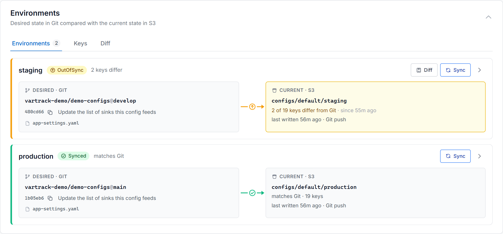

# The full demo

The plain demo ([Getting started](../getting-started.md#option-a-the-demo-fastest)) runs MongoDB, Redis, ZooKeeper, S3 on MinIO and a Linux server over SSH. The full demo adds Kubernetes ConfigMaps and Helm releases, a second Git server and a second tenant, so the web UI shows what varTrack does across platforms, tenants and layered rules.

## Start it

`demo/docker-compose.live.yml` adds Kubernetes ConfigMaps and Helm releases on k3s and a second Gitea, and seeds every sink through real Gitea pushes and webhooks:

```bash
cd demo
docker compose -f docker-compose.yml -f docker-compose.live.yml up -d --build \
  gitea redis mongo zookeeper minio minio-init vault vault-init \
  k3s k3s-kubeconfig orchestrator-api orchestrator-worker gateway watcher live-seed

cd ../ui && npm install && npm run dev
```

The images generate their own Python and Go protobuf stubs, so `buf generate` on the host is not needed to run the stack. Open the UI at http://localhost:5173 (this stack's sign-in redirects there, so the dev server must be running; the plain demo's is http://localhost:8080). Two Git servers feed the demo, so sign-in covers two platforms: **gitea** (http://localhost:3000, the demo configs) and **gitea-team** (http://127.0.0.1:3001, a payments team with a private repository). Sign in with one and connect the other — every password is `VarTrack123`:

| Sign in to gitea as… | then connect gitea-team as… | you see |
|---|---|---|
| `demo-admin` | `team-admin` | all 7 rules on one page, and can sync them: the 6 demo rules of tenant `default` and the payments rule of tenant `payments`, with no tenant to switch to |
| `demo-viewer` | `demo-viewer` | the 6 demo rules, dry runs only (Sync is disabled and says why; a dry run's log shows in the panel); the payments rule stays hidden — not in that team |

The demo's rule settings come in layers ([how a rule is built](../configuration/schema-registry.md#how-a-rule-is-built)):

| Layer | In the demo |
|---|---|
| `config.cue` | `demo/live/config.cue`: every rule, the datasources' connections, Vault |
| a tenant's `bundle.json` | tenant `default`: `vartrack-demo/schemas` on gitea, `extends` the `production` preset · tenant `payments`: `payments/schemas` on gitea-team, `extends` the `team` preset on gitea |
| a repo's `vartrack.json` | `demo-configs` has one on `main` and a different one on `develop`; `payments-config` has `.gitea/vartrack.json`, extending a preset in the payments team's own schema repo |
| presets | `vartrack-demo/presets` (`demo/live/presets`): each layer adds `prune.protection` patterns |

Every environment shows its desired state in Git next to the current state in its sink. See [Web UI sign-in](../configuration/auth.md#web-ui-sign-in-with-your-git-platform) to turn sign-in off or set it up for your own platforms.



## The CLI in the full demo

What `vt` may do is what your Git token may do in the rule's repositories: push access syncs, read access validates and dry-runs. In the full demo, make a Gitea token and use it:

```bash
TOKEN=$(curl -s -u demo-admin:VarTrack123 -X POST -H "Content-Type: application/json" \
  -d '{"name":"vt","scopes":["read:user","read:repository"]}' \
  http://localhost:3000/api/v1/users/demo-admin/tokens | python3 -c "import sys,json;print(json.load(sys.stdin)['sha1'])")
vt login --server http://localhost:5657 --token "$TOKEN"
vt sync --file app-settings.yaml --datasource mongo-primary --env staging --wait   # the full demo's rule tracks app-settings.yaml
```

`demo-admin` administers the demo repositories, so it can sync anywhere; `demo-viewer` can only read them, so it can validate and dry-run but not sync ([the example OPA policy](https://github.com/jarin-devoss/varTrack/blob/main/examples/policies/vartrack_authz.rego) adds: writers never sync production or `configs/secrets/*`). The same token, pasted into the *Git token* card on the UI's Playground page, drives the Playground.
