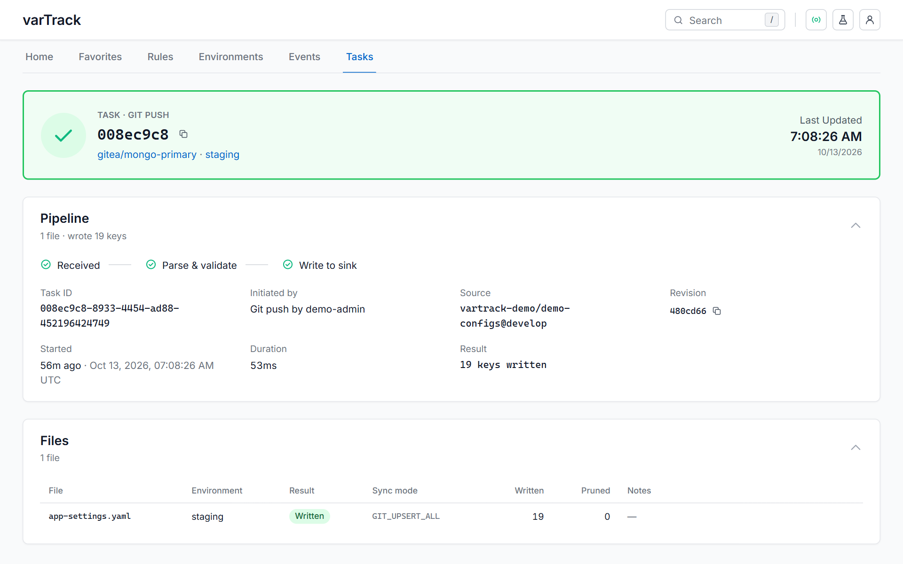

# orchestrator-service

The orchestrator-service runs the ETL pipeline. It receives webhook events from the gateway via gRPC, fetches the changed file from Git, parses and validates it, then writes the config values to every configured sink.

---

## What it does

```
gateway (gRPC) → Celery task → fetch Git → parse → flatten → validate CUE → write sinks
```

Three stages:

1. **Payload** — resolve rule, platform, and target environment
2. **ETL** — fetch from Git, parse, flatten to `key: value` map, validate against CUE schema
3. **Sync** — write to sinks, prune stale keys, rollback on failure

---

## Running

```bash
cd orchestrator-service
pip install -e .

# API + gRPC server
uvicorn main:app --host 0.0.0.0 --port 8000

# Celery worker (separate terminal)
celery -A app.worker.celery worker --queues=webhooks,sync -l info
```

### With Docker

```bash
# API server
docker run \
  -p 8000:8000 \
  -p 50051:50051 \
  -e CONFIG_PATH=/config.cue \
  -v ./config.cue:/config.cue:ro \
  jarin-devoss/orchestrator-service:latest

# Celery worker
docker run \
  -e CONFIG_PATH=/config.cue \
  -v ./config.cue:/config.cue:ro \
  jarin-devoss/orchestrator-service:latest \
  celery -A app.worker.celery worker --queues=webhooks,sync -l info
```

---

## Environment variables

| Variable | Default | Description |
|---|---|---|
| `APP_ENV` | `development` | `production` enforces mTLS |
| `CELERY_BROKER_URL` | `redis://localhost:6379/0` | Celery broker |
| `CONFIG_PATH` | `config.cue` | CUE bundle path |
| `GIT_CACHE_DIR` | `/tmp/vt_gitcache` | Directory of the bare Git mirrors, one per repository. Give the API and every worker the same directory (a shared volume) to clone once per host |
| `GIT_CACHE_MAX_ENTRIES` | `20` | Mirrors kept; past that the least recently used are removed, never one in use |
| `SCHEMA_CACHE_DIR` | `/tmp/schema_registry` | CUE schema clone directory |
| `ORCHESTRATOR_ADDR` | `:50051` | gRPC listen address |
| `UI_DEFAULT_TENANT` | `default` | Tenant the web UI reads when no tenant is registered at all |
| `UI_COMPARE_TTL_SECONDS` | `10` | How long a sink comparison is answered as is before it is refreshed in the background |
| `UI_AUTH_PLATFORMS` | — | Web UI sign-in when the bundle has no `ui.auth` block; see [Web UI sign-in](../configuration/auth.md#web-ui-sign-in-with-your-git-platform) |

---

## API

### HTTP (port 8000)

| Method | Path | Description |
|---|---|---|
| `POST` | `/v1/webhooks/{datasource}` | Ingest webhook, enqueue ETL task |
| `POST` | `/v1/webhooks/{datasource}/dry-run` | Simulate without writing |
| `GET` | `/v1/tasks/{task_id}` | Poll task status |
| `GET` | `/v1/health` | Liveness probe |
| `GET` | `/metrics` | Prometheus metrics |
| `GET` | `/docs` | OpenAPI / Swagger UI |

### Web UI read API (port 8000)

The web UI reads everything it shows from these endpoints. They cover every registered tenant at once and answer with what the viewer's Git permissions allow (see [Tenants are shown, not chosen](../configuration/auth.md#tenants-are-shown-not-chosen)); `?tenant=` or the `X-Tenant-ID` header narrows an answer to one tenant. A rule endpoint without `?tenant=` takes the only visible tenant that has the rule, and answers `409` when several do.

| Method | Path | Description |
|---|---|---|
| `GET` | `/v1/ui/rules` | Every visible rule, of every tenant, with one target per synced environment; `hidden` counts rules on platforms the user has not connected |
| `GET` | `/v1/ui/rules/{platform}/{datasource}` | One rule |
| `GET` | `/v1/ui/rules/{platform}/{datasource}/targets/{env}/keys` | Desired value (Git) and current value (sink) of every key |
| `POST` | `/v1/ui/rules/{platform}/{datasource}/sync` | Re-sync environments from the branch head in Git — body `{"envs": [], "dryRun": false, "prune": false}` |
| `GET` | `/v1/ui/events?rule=&limit=` | Pushes, syncs, drift and heals, newest first |
| `GET` | `/v1/ui/tasks?rule=&limit=` | Sync tasks, newest first |
| `GET` | `/v1/ui/tasks/{task_id}` | One task with its per-file results |
| `GET` | `/v1/ui/bundle` | Platforms and datasources, without credentials; `tenants` lists the visible tenants and each datasource names its rules as `{tenant, name}` |

Every sync records the desired state it wrote (secret values only as a digest), its task and its events in Redis next to the Celery broker. Reading a rule compares that desired state with the values read back from the sink, so drift shows key by key even for rules without `self_heal`.

A task as the UI shows it from `GET /v1/ui/tasks/{task_id}` — its pipeline stages and per-file results:



Pages never wait on a sink they have read before. Each comparison is cached: for `UI_COMPARE_TTL_SECONDS` (default 10) it is answered as is, and after that it is still answered at once while the sink is read again in the background — every target shows when it was last checked. The API reads every sink once at startup, and the schema registry's periodic `git fetch` also runs behind requests. Only an environment not read since its last sync is read while the request waits.

With sign-in set up (the bundle's `ui.auth` block), every `/v1/ui/*` endpoint needs a signed-in session and answers only with the rules, environments, tasks and events the user's Git platforms let them see — each rule on its own platform; syncing needs write access to the rule's repository. Sign-in lives under `/v1/auth`:

| Method | Path | Description |
|---|---|---|
| `GET` | `/v1/auth/session` | Is sign-in on, on which platforms, and who is signed in where |
| `GET` | `/v1/auth/login?platform=&return_to=` | Start signing in (or connect another platform): redirects to the platform |
| `GET` | `/v1/auth/callback` | The platform returns here |
| `POST` | `/v1/auth/logout` | End the session on every platform |

### gRPC (port 50051)

| RPC | Called by | Description |
|---|---|---|
| `ProcessWebhook` | gateway-service | Enqueue ETL pipeline |
| `CheckDatasource` | watcher-service | Does the datasource still match Git? `in_sync`, `drifted`, `syncing` or `unknown`, per environment |
| `SyncDatasource` | watcher-service | Re-sync one datasource from Git on drift (self-heal) |
| `CLIService.SyncFile` | gateway-service | `vt sync`: run a file's content through the pipeline for the rule of its datasource |
| `CLIService.ValidateFile` | gateway-service | `vt validate`: parse and check a file against the tenant's schema |
| `CLIService.ValidateConfig` | gateway-service | `vt validate-config`: check a `vartrack.json` or `bundle.json` the way a sync would read it |
| `CLIService.GetTask`, `ListTasks` | gateway-service | `vt task`: a CLI sync task, recent CLI tasks |

The gateway calls `CLIService` only after a request passed its [Git permission and OPA checks](../configuration/auth.md), and names the caller (`login@platform`) in the `x-cli-user` metadata; the task records it. A CLI sync belongs to the rule for its datasource: in the web UI it shows under that rule, marked **CLI**.
