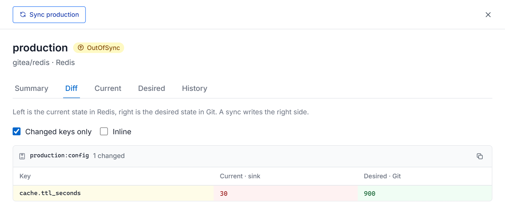
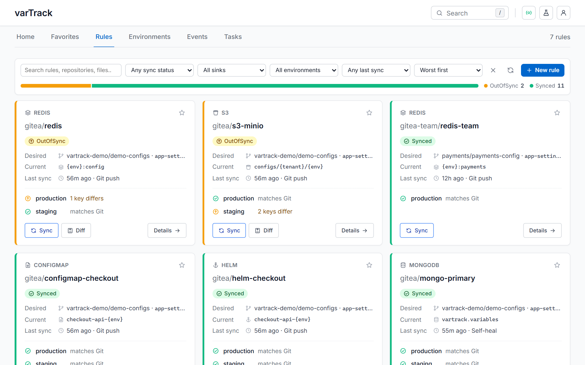

# varTrack UI

A web console for varTrack: what is in sync with Git, what drifted, and what every sync did.

| Screen | What it answers |
|---|---|
| **Home** (`/home`) | Is anything wrong right now? A status card for the whole tenant (click it to see the affected rules), the environments that need attention, tenant facts, service health, per-sink totals and recent events. |
| **Favorites** | The rules you starred, as the same boxes as the Rules list. |
| **Rules** | Every rule as a box: its sync status, the desired state (repository and file in Git) next to the current state (sink and destination), the last sync, and one line per environment. Filter by sync status, sink, environment and last sync; the status bar under the filters filters too. Filters live in the URL. **New rule** writes the CUE to add to `config.cue`. |
| **Rule** | A status card, actions (Sync, Dry run, Diff, Refresh), three summary boxes (sync status, self-heal, last sync), an **Environments** panel with one box per environment — desired state in Git on the left, current state in the sink on the right — plus the key table and a full diff, and a **Rule** panel (overview with environment resolution, sync history, events, CUE definition). Opening an environment shows its **Summary**, **Diff** (current and desired side by side), **Current** values, **Desired** values and **History**. |
| **Environments** | Every environment of every rule, out of sync first; expand one to see desired vs current. |
| **Events** | Pushes, syncs, drift, heals and prunes, newest first, with repeats folded together. |
| **Tasks** | Every pipeline run; expand for stages and per-file results, or open a task by ID (the one `vt sync` prints). |
| **Playground** | Paste a config file, see the flattened keys varTrack will extract, validate it, or dry-run it. |
| **Settings, Profile** | Service URLs and tenant, datasources and platforms, theme; who you are signed in as. |

Configuration stays in Git: the UI shows rules and the bundle read-only. The actions it offers are the ones that also exist outside Git — re-sync from Git, dry run, and `vt sync`-style pushes from the Playground. Pruning a production-like environment (`prod`, `production`, `main`, `master`, `live`) asks you to type `prune` first.

## Run it

```bash
cd ui
npm install
npm run dev          # http://localhost:5173
```

The UI shows your varTrack services — there is no built-in sample data. Start them first (the live stack below runs everything locally). The dev server proxies:

| Path | Default target | Override |
|---|---|---|
| `/api/gateway` | `http://localhost:5657` | `VT_GATEWAY_URL` |
| `/api/orchestrator` | `http://localhost:8000` | `VT_ORCHESTRATOR_URL` |
| `/api/watcher` | `http://localhost:9091` | `VT_WATCHER_URL` |

Other scripts: `npm run build` (type-check + production build into `dist/`), `npm test`, `npm run typecheck`.

### Docker

`docker compose up -d` from the repo root also builds and starts the UI on port 8080 (`UI_PORT` to change it). The image serves the static build with nginx and proxies the same `/api/*` paths; point them elsewhere with `GATEWAY_URL`, `ORCHESTRATOR_URL` and `WATCHER_URL`. Upstreams are resolved per request, so a missing service answers 502 instead of stopping nginx.

## Signing in

When the bundle has single sign-on set up (its `ui.auth` block), the UI asks you to **Sign in with GitHub** or **Gitea**. You then see the rules whose repositories that platform lets you read, and can sync the ones you can write to; read-only rules offer a dry run. With rules on both, sign in with one and **Connect** the other (sign-in page, user menu or profile) — each rule is judged with your account on its own platform. Your platform token stays on the server; the browser keeps only a session cookie. Setup, scopes and every setting: [Web UI sign-in](../docs/configuration/auth.md#web-ui-sign-in-with-your-git-platform).

Without single sign-on the UI is open to anyone who can reach it. The Playground's validate and push go through the gateway's CLI API, which takes the bearer token `vt login` uses: paste it under *API token for the Playground* on the sign-in page (kept in memory for the tab only).

## Live data

The `/v1/ui/*` read API lives in the orchestrator. It reads rules from the tenant's schema registry (`bundle.json`), the desired state each sync wrote from Git, and the current state read back from every sink, so each environment shows Synced or OutOfSync key by key. Tasks and events are recorded by the orchestrator as syncs run.



Loading stays fast because nothing waits on a sink twice. The orchestrator answers from its last comparison and re-reads sinks in the background (`UI_COMPARE_TTL_SECONDS`, "Last checked" on every environment). In the browser, screens asking for the same data share one request and one cached answer: a page you open again shows what it had at once and refreshes behind, and a rule opened from a list starts from the list's copy.

| Screen | Endpoint (orchestrator unless noted) |
|---|---|
| Service health | `GET /health/readiness` (gateway, watcher), `GET /v1/health/readiness` |
| Home, rules, environments | `GET /v1/ui/rules`, `GET /v1/ui/rules/{platform}/{datasource}` |
| Keys, diff, current and desired values | `GET /v1/ui/rules/{platform}/{datasource}/targets/{env}/keys` |
| Sync from Git | `POST /v1/ui/rules/{platform}/{datasource}/sync` with `{ "envs": string[], "dryRun": bool, "prune": bool }` |
| Events | `GET /v1/ui/events?rule=&limit=` |
| Tasks, task page | `GET /v1/ui/tasks?rule=&limit=`, `GET /v1/ui/tasks/{task_id}` (falls back to `GET /v1/tasks/{task_id}`) |
| Tenant, datasources | `GET /v1/ui/bundle` — endpoints without credentials |
| Playground | `POST /v1/cli/validate`, `POST /v1/cli/sync` (gateway; only when the bundle configures `auth`) |

Responses are JSON in the shapes defined in [`src/api/types.ts`](src/api/types.ts). The tenant is the `X-Tenant-ID` header (Settings → Connection), defaulting to the orchestrator's `UI_DEFAULT_TENANT`.

### A live stack with real sinks

`e2e/docker-compose.live.yml` runs the whole system with MongoDB, ZooKeeper, Redis, S3 (MinIO), and Kubernetes ConfigMaps and Helm releases on k3s, fed by real pushes through Gitea webhooks. See the comment at the top of that file for the command; then open the UI.

## Keyboard

| Keys | Action |
|---|---|
| `/` or `Ctrl`+`K` | Search rules, environments and pages |
| `g` then `h` `f` `r` `e` `v` `t` `p` `s` | Home, Favorites, Rules, Environments, Events, Tasks, Playground, Settings |
| `l` | Pause or resume live updates |
| `?` | All shortcuts |
| `Esc` | Close search, a dialog or a panel |

## Layout

```
src/
  api/          types and the client for the varTrack services
  lib/          status vocabulary, filtering, config parsing, diff, prefs, polling, hotkeys
  components/   status pills, hero card, panels and tabs, two-line rows, filter bar, status chart, overlays
  features/     rule boxes, environment boxes and panel (desired vs current), rows, sync and new-rule panels, rule tabs
  layout/       header, quick search, user menu, section tabs, footer
  pages/        one file per route
  styles/       design tokens (light and dark) and component styles
```

Every environment has a sync status that compares the current state in the sink with the desired state in Git: **Synced**, **OutOfSync** (drifted, being healed, or self-heal gave up) or **Unknown** (not watched, or the sink couldn't be read). Extra pills appear only when they add something: *Healing* or *Heal failed* from self-heal, and *Sync running* or *Sync failed* for the last sync. Status always shows as an icon or a labelled pill, never color alone: green synced, yellow out of sync, blue running, red failed, gray unknown. Inter is bundled, so the UI needs no internet access.


